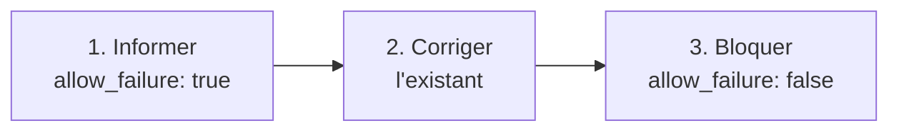
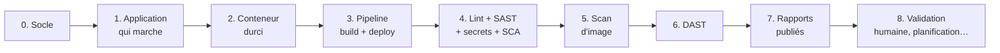
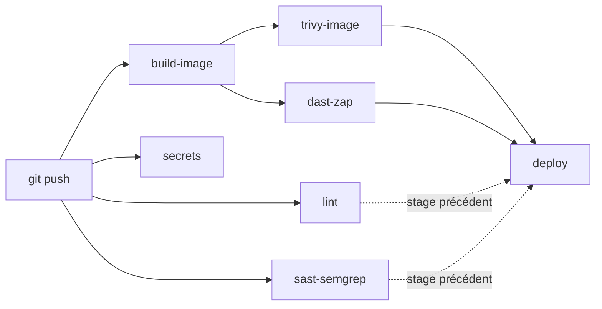
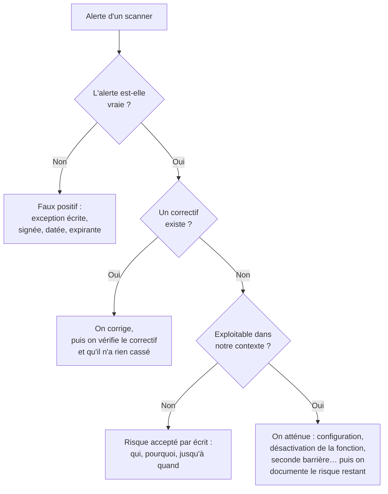

# Cours : construire un pipeline DevSecOps, la méthode réutilisable

> Tiré du TP **INFAL245 — Transformation DevSecOps** (site statique + GitLab CI).
> Ce document ne recopie pas l'énoncé. Il en garde **ce qui reste vrai quand le projet, le langage ou l'outil changent**, et il vous donne une méthode, des modèles et des listes de contrôle pour l'appliquer ailleurs.

---

## Sommaire

- [Ce que le TP voulait vraiment enseigner](#ce-que-le-tp-voulait-vraiment-enseigner)
- [Partie 1 — Les idées fondamentales](#partie-1--les-idées-fondamentales)
- [Partie 2 — La méthode pas à pas](#partie-2--la-méthode-pas-à-pas-applicable-à-tout-projet)
- [Partie 3 — La boîte à outils (modèles à copier)](#partie-3--la-boîte-à-outils-modèles-à-copier)
- [Partie 4 — Adapter à une autre stack](#partie-4--adapter-à-une-autre-stack)
- [Partie 5 — Les méthodes transverses](#partie-5--les-méthodes-transverses)
- [Partie 6 — Checklist pour un nouveau projet](#partie-6--checklist-pour-un-nouveau-projet)
- [Partie 7 — Auto-évaluation](#partie-7--auto-évaluation)
- [Glossaire](#glossaire)

---

## Ce que le TP voulait vraiment enseigner

Le site web n'était qu'un prétexte. Le TP enseignait cinq choses :

1. **Automatiser la livraison** : chaque `git push` construit, contrôle et publie le projet, toujours de la même façon, avec une trace.
2. **Déplacer la sécurité vers la gauche** (*shift-left*) : on contrôle le plus tôt possible, parce qu'un défaut coûte plus cher à chaque étape qu'il franchit.
3. **Empiler des contrôles différents** (lint, SAST, scan d'image, DAST), parce que chacun est aveugle à ce que voient les autres.
4. **Décider face à une alerte** : corriger, ou accepter le risque par écrit. On ne fait jamais taire un scanner en douce.
5. **Comprendre chaque ligne** de ce qu'on automatise. Un pipeline qu'on ne comprend pas, on ne sait pas le réparer.

La phrase qui résume tout : **un pipeline vert ne prouve pas que le code est sûr.** Dans votre TP, la seule vraie faille (la XSS dans `app.js`) n'a été trouvée par aucun outil.

---

## Partie 1 — Les idées fondamentales

### 1.1 De DevOps à DevSecOps

Avant DevOps, il y avait un mur. Les développeurs voulaient livrer vite, l'exploitation voulait que rien ne casse, et chaque équipe optimisait son côté du mur. DevOps réunit ces équipes autour d'un objectif commun : **livrer souvent, et de façon fiable**.

DevSecOps ajoute la sécurité à cet objectif. Elle n'est plus un audit de dernière minute fait par une autre équipe. Elle devient l'affaire de toute l'équipe, et elle est **vérifiée automatiquement à chaque commit**.

Une transformation DevSecOps repose sur **trois piliers**, qui avancent ensemble :

| Pilier | Ce qu'il recouvre | Dans le TP |
|---|---|---|
| **Les personnes** | Culture sans blâme, rôles clairs, un *Security Champion* dans l'équipe | La règle « chaque ligne du pipeline tapée et comprise » ; la signature des acceptations de risque |
| **Le processus** | Petites livraisons fréquentes, pipeline automatisé, indicateurs | Un commit par étape, un pipeline par commit, le cliquet `allow_failure` |
| **Les outils** | Conteneurs, CI/CD, contrôles de sécurité automatisés | Docker, GitLab CI, HTMLHint, Semgrep, Trivy, OWASP ZAP |

Un outil seul ne transforme pas une organisation : une équipe qui ne lit pas les rapports, ou qui désactive le scanner quand il bloque, n'a rien gagné.

**Les indicateurs DORA** mesurent la performance de livraison d'une équipe :

| Indicateur | Question |
|---|---|
| Fréquence de déploiement | À quelle fréquence livre-t-on en production ? |
| Délai de mise en production | Combien de temps entre un commit et sa mise en production ? |
| Taux d'échec des changements | Quelle part des livraisons provoque un incident ? |
| Temps de restauration | Combien de temps pour revenir à un service normal après un incident ? |

Un bon pipeline améliore les quatre à la fois : il livre plus souvent, plus vite, casse moins, et permet de revenir en arrière en redéployant l'image précédente.

### 1.2 Les dix idées à retenir

Ces idées valent pour n'importe quel projet. Pour chacune : ce que c'est, où vous l'avez vue dans le TP, et le réflexe à garder.

#### 1. Tout automatiser, tout versionner (*pipeline as code*)

Le pipeline est décrit dans un fichier (`.gitlab-ci.yml`) versionné avec le code. Il fait la même chose à chaque `git push`, sans oubli, et chaque exécution laisse un journal.

- **Dans le TP** : à partir du TP 3, plus rien n'est construit ni publié à la main.
- **Réflexe** : si une tâche de livraison se fait à la main, elle finira par être oubliée ou mal faite. Mettez-la dans le pipeline.

#### 2. Construire une fois, déployer partout (immuabilité)

Un conteneur embarque l'application **et** son environnement d'exécution (serveur, bibliothèques, configuration). La même image tourne à l'identique sur le poste, dans le pipeline et en production. L'image testée par le pipeline est exactement celle qu'on livre.

- **Dans le TP** : FTP déplaçait des fichiers ; l'image Docker livre un environnement complet, versionné et reproductible.
- **Réflexe** : on ne modifie jamais un livrable après sa construction. On reconstruit.

#### 3. Tout tracer (une version = un commit)

L'image porte le numéro du commit (`$CI_COMMIT_SHORT_SHA`), jamais `latest`. On sait toujours ce qu'elle contient, quel pipeline l'a construite et quoi redéployer en cas de retour arrière.

- **Piège** : `latest` ne veut pas dire « la plus récente ». C'est seulement l'étiquette par défaut, écrasée à chaque push. Deux pipelines simultanés peuvent même scanner l'image l'un de l'autre.
- **Réflexe** : étiquette immuable = SHA du commit (et, pour une version publique, une étiquette sémantique `1.4.2` en plus).

#### 4. Shift-left : chaque contrôle le plus tôt possible

Le coût de correction d'un défaut augmente à chaque étape qu'il franchit : code → build → test → déploiement → production.

**Shift-left ne veut pas dire « tout au début ».** Cela veut dire : chaque contrôle le plus tôt possible, **compte tenu de ce dont il a besoin**.

| Contrôle | Ce dont il a besoin | Il peut démarrer… |
|---|---|---|
| Lint, SAST, secrets, dépendances | Le code source | Dès le `git push` (`needs: []`) |
| Scan d'image | L'image construite | Juste après le build (`needs: [build-image]`) |
| DAST | L'application en marche | Juste après le build, en parallèle du scan d'image |

- **Réflexe** : déclarez les vraies dépendances de chaque job (`needs`), au lieu de tout faire attendre stage par stage.

#### 5. Défense en profondeur

Aucun contrôle ne voit tout. On empile donc des contrôles qui ne regardent pas la même chose, **et** on ajoute des protections qui limitent les dégâts quand une faille passe quand même.

- **Dans le TP** : la XSS est corrigée dans le code (`textContent`), **et** la Content Security Policy de Nginx bloque le script injecté si la faille revient. Vous l'avez vérifié en remettant temporairement `innerHTML`.
- **Réflexe** : pour chaque faille corrigée, demandez-vous quelle seconde barrière aurait limité les dégâts.

#### 6. Moindre privilège

Chaque composant n'a que les droits dont il a strictement besoin.

- **Dans le TP** :
  - Nginx tourne avec l'utilisateur `nginx` (UID 101), pas en root (`nginx-unprivileged`, port 8080) ;
  - on repasse root uniquement le temps d'un `apk upgrade`, puis `USER 101` immédiatement ;
  - les identifiants du registre (`$CI_REGISTRY_PASSWORD`) sont fournis par GitLab, valables pour un seul job ;
  - le mot de passe passe par `--password-stdin`, jamais en argument (sinon il apparaît dans les journaux) ;
  - le jeton d'accès Git a la seule portée `write_repository`.
- **Réflexe** : à chaque droit accordé (utilisateur, jeton, port, volume), demandez-vous ce qu'un attaquant ferait avec.

#### 7. La barrière de sécurité et le cliquet

Un contrôle bloquant (*security gate*) empêche la publication d'une version qu'on sait défaillante. Mais activer un scanner bloquant sur un projet existant fait souvent tout casser d'un coup, et l'équipe finit par désactiver le scanner.

La stratégie du **cliquet**, qui ne revient jamais en arrière :



- **Dans le TP** : HTMLHint et Semgrep démarrent en `allow_failure: true`, on corrige les trois défauts, puis on supprime `allow_failure`. Désormais, toute régression bloque le pipeline.
- **Réflexe** : un nouveau contrôle entre toujours en mode « informer », avec une date pour passer en mode « bloquer ».

#### 8. Décider face à une alerte, et tracer la décision

Face à une alerte, il y a deux bonnes réponses :

- **un correctif existe** → on corrige ;
- **pas de correctif, ou faille non exploitable chez nous** → on accepte le risque **par écrit** : qui, pourquoi, jusqu'à quand.

Et trois mauvaises : supprimer le scanner, remettre `allow_failure: true` « en attendant », ignorer l'alerte sans rien dire.

Ne confondez pas :

- un **faux positif** : « l'alerte est fausse » ;
- un **risque accepté** : « l'alerte est vraie, mais on choisit de vivre avec pour l'instant ».

Dans les deux cas, on écrit la justification, dans un fichier versionné et relu en revue de code (`.trivyignore`), avec une date d'expiration.

- **Réflexe** : accepter un risque qu'une simple mise à jour supprime, ce n'est pas une décision de sécurité, c'est de la dette.

#### 9. Un pipeline vert ne prouve pas l'absence de faille

Un outil ne trouve que ce que ses règles décrivent. Dans votre TP, Semgrep a passé 153 règles JavaScript sur `app.js` sans voir la XSS : les outils ont attrapé les deux défauts les moins graves et laissé passer le seul vrai problème de sécurité.

- **Réflexe** : gardez une **revue humaine** du code (merge request, relecture), et **démontrez une faille avant de la corriger** (rejouez l'attaque, puis vérifiez qu'elle ne marche plus).

#### 10. Rendre la sécurité visible, mais pas publique

Un rapport enterré dans un journal de job, personne ne le lit. On publie donc les rapports (tableau de bord), mis à jour à chaque commit.

- **Dans le TP** : `/reports/trivy.html` et `/reports/zap.html` publiés sur GitLab Pages.
- **En entreprise** : publier ses rapports sur Internet, c'est donner à un attaquant la liste de ses faiblesses. On restreint l'accès aux membres du projet.

### 1.3 Qui voit quoi : la carte des contrôles

C'est le tableau le plus important du cours. Pour chaque contrôle : la question qu'il pose, ce qu'il voit et ce qu'il **ne verra jamais**.

| Contrôle | Question posée | Il voit | Il ne voit pas | Type | Outils (TP · alternatives) |
|---|---|---|---|---|---|
| **Lint** | Le code est-il bien écrit ? | Syntaxe, conventions, accessibilité | Les failles de logique, le reste de l'image | Statique | HTMLHint · ESLint, Ruff, Checkstyle |
| **SAST** | Le code contient-il un motif dangereux ? | **Votre code source**, sans l'exécuter | La config du serveur, les composants tiers, la logique métier, les zero-days | Boîte blanche | Semgrep · CodeQL, SonarQube, Bandit |
| **Détection de secrets** | Un mot de passe ou une clé a-t-il été commité ? | Le code **et l'historique Git** | Les secrets qui ne ressemblent à aucun motif connu | Statique | *(absent du TP)* · Gitleaks, TruffleHog |
| **SCA (dépendances)** | Mes bibliothèques ont-elles des CVE connues ? | Les fichiers de dépendances (`package-lock.json`, `requirements.txt`…) | Votre propre code, les paquets système | Statique | *(absent du TP)* · Trivy `fs`, npm audit, Dependabot |
| **Scan d'image** | Les composants que je livre ont-ils des CVE ? | **Tout le contenu de l'image** : OS, serveur, bibliothèques | Votre code, la config servie, le comportement | Statique (sur le binaire) | Trivy · Grype, Docker Scout |
| **Analyse IaC / Dockerfile** | Mon infrastructure est-elle bien configurée ? | Dockerfile, Kubernetes, Terraform | Ce qui tourne réellement | Statique | *(absent du TP)* · Trivy `config`, Hadolint, Checkov |
| **DAST** | L'application en marche se comporte-t-elle mal ? | **Les réponses HTTP** : en-têtes, cookies, fuites d'information | Le code, les composants, les pages qu'il ne trouve pas | Boîte noire | OWASP ZAP · Burp, Nuclei |
| **Revue humaine** | Est-ce que ça a du sens ? | La logique métier, les contrôles d'accès oubliés, l'intention | Ce que la fatigue fait rater | — | Merge request + approbation |

**Les deux familles à ne pas confondre :**

- **Boîte blanche (SAST)** : on lit le code sans l'exécuter. Ça marche dès le commit, mais on ne voit pas l'environnement.
- **Boîte noire (DAST)** : on attaque l'application en marche, de l'extérieur, comme un attaquant, sans voir le code. Il faut d'abord la construire et la lancer.

### 1.4 Ce que le TP a démontré

| Défaut volontaire | Trouvé par | Leçon |
|---|---|---|
| Image sans attribut `alt` (`index.html`, l. 33) | HTMLHint, règle `alt-require` | Le lint attrape les défauts de qualité et d'accessibilité |
| Lien en `http://` sans `rel="noopener noreferrer"` (l. 38) | Semgrep pour le `http://` ; **aucun outil** pour le `rel` | Un outil voit une partie du problème, pas forcément tout |
| XSS : `innerHTML` reçoit le prénom venu de l'URL (`app.js`, l. 6) | **Aucun outil**, trouvée à la main | La faille la plus grave est passée à travers. D'où la revue humaine |

Et trois autres constats, aussi importants :

- **Trivy est passé au rouge sans qu'une ligne de code change.** Une CVE venait d'être publiée dans `libexpat`, une bibliothèque d'Alpine. Les composants vieillissent même si votre code ne bouge pas.
- **Les alertes de ZAP ne venaient pas du code**, mais de la configuration de Nginx (en-têtes absents, version affichée). Ni Semgrep ni Trivy ne pouvaient les voir.
- **Un correctif de sécurité peut en casser un autre** : `apk upgrade` demande root, et oublier `USER 101` ensuite recrée le problème de privilèges du TP 2. Un correctif se vérifie aussi.

---

## Partie 2 — La méthode pas à pas (applicable à tout projet)

Le TP suit un ordre précis, et cet ordre est réutilisable tel quel. Chaque étape s'appuie sur la précédente, et chacune se termine par un **point de contrôle** : on ne passe pas à la suite tant que ça ne marche pas.



> 💡 **La règle d'or de la méthode** : à chaque étape, **le pourquoi d'abord, le comment ensuite**. Un commit par étape, avec un message clair. Tester en local avant de pousser.

### Étape 0 — Le socle

Un pipeline a besoin de trois choses : un endroit pour stocker le code (GitLab, GitHub…), une machine pour exécuter les tâches (un **runner**), et un moyen d'envoyer le code (Git).

À vérifier :

- [ ] `git`, `docker` et l'éditeur répondent en ligne de commande ;
- [ ] l'identité Git est configurée (`user.name`, `user.email`, `init.defaultBranch main`) ;
- [ ] une clé SSH `ed25519` est créée ; seule la clé **publique** (`.pub`) est donnée à la forge ;
- [ ] un runner est disponible (sur gitlab.com, il faut un compte vérifié, sinon les jobs restent en *pending*) ;
- [ ] le dépôt distant est relié : `git remote add origin …` puis `git push -u origin main`.

> ⚠️ La clé privée (`id_ed25519`, sans `.pub`) ne quitte jamais votre poste. Si le port SSH est bloqué, utilisez un jeton d'accès avec la **portée minimale** (`write_repository`).

### Étape 1 — Une application minimale qui fonctionne

On ne sécurise pas ce qui ne tourne pas. On part d'une application simple, on vérifie qu'elle marche en local, on la pousse. Toute l'attention doit aller à la chaîne de livraison, pas au code.

### Étape 2 — Conteneuriser proprement

**Image ou conteneur ?**

| | Image | Conteneur |
|---|---|---|
| Ce que c'est | Un modèle figé, en lecture seule | Une instance qui tourne à partir de l'image |
| Obtenu par | `docker build` | `docker run` |
| Vit | Sur le disque, ou dans un registre | En mémoire, comme un processus |
| Durée de vie | Permanente, identifiée par une étiquette | Jetable |
| Analogie | La recette, la classe | Le plat, l'objet |

**Les règles d'un Dockerfile durci :**

1. **Image de base officielle et minimale** (`-alpine`, `-slim`, *distroless*). Moins de composants, c'est moins de CVE.
2. **Variante non root** quand elle existe (`nginxinc/nginx-unprivileged`), sinon créer un utilisateur et finir par `USER <uid>`.
3. **Port supérieur à 1024** : un utilisateur non root ne peut pas écouter sur le port 80.
4. **Mettre à jour les paquets au build** (`apk upgrade --no-cache`, `apt-get upgrade`), en repassant root le moins longtemps possible.
5. **Un `.dockerignore`** pour ne pas embarquer `.git`, la config CI, les secrets (`.env`, clés), la documentation.
6. **Copier une configuration serveur durcie** (étape 6) plutôt que garder celle par défaut.
7. **Multi-stage** pour les applications compilées : les outils de build restent dans la première étape, l'image finale ne contient que le résultat (voir partie 3.3).

**Toujours vérifier en local :**

```bash
docker build -t monprojet:local .
docker run -d --name app -p 8080:8080 monprojet:local
docker ps                         # le conteneur est-il Up ?
curl -I http://localhost:8080     # répond-il, et avec quels en-têtes ?
docker exec app id                # sous quel utilisateur ? (jamais uid=0)
docker logs app
docker image ls monprojet         # quelle taille ?
docker stop app && docker rm app
```

### Étape 3 — Le premier pipeline : build → registre → déploiement

**Le vocabulaire :**

| Mot | Définition |
|---|---|
| **Pipeline** | L'ensemble des tâches déclenchées par un événement (`git push`, planification, merge request) |
| **Stage** | Une étape. Les stages s'exécutent **dans l'ordre** |
| **Job** | Une tâche. Les jobs d'un même stage s'exécutent **en parallèle** |
| **Runner** | La machine qui exécute un job, dans un conteneur jetable |
| **`image`** | L'image Docker dans laquelle tourne le job (elle fournit ses outils) |
| **`services`** | Des conteneurs lancés à côté du job, joignables par le réseau |
| **Artifacts** | Les fichiers produits par un job et conservés par GitLab |
| **Variables prédéfinies** | Fournies par GitLab : `$CI_COMMIT_SHORT_SHA`, `$CI_REGISTRY`… |

**Ce que fait le job de build, et pourquoi :**

- Il construit l'image et la **range dans un registre** (le *Container Registry* du projet), pour que les jobs suivants, et la production, utilisent exactement la même image.
- Le job tourne lui-même dans un conteneur. Pour y construire une image, on lui adjoint un moteur Docker voisin : c'est **Docker-in-Docker** (`services: docker:dind`), joint en TLS (`DOCKER_HOST`, `DOCKER_TLS_*`).
- Le moteur met quelques secondes à démarrer : on l'attend (`until docker info …`).
- On se connecte au registre avec des identifiants **temporaires**, propres au job, passés par `--password-stdin`.

**Ce que fait le job de déploiement :**

- Il ne tourne que sur la branche principale (`rules: if $CI_COMMIT_BRANCH == $CI_DEFAULT_BRANCH`).
- Il ne s'exécute que si les jobs dont il dépend ont réussi. **Un job raté arrête la chaîne : rien n'est mis en ligne, et l'ancienne version reste en ligne, intacte.**

> 💡 **Deux livrables, une même source.** Dans le TP, GitLab Pages sert les fichiers statiques et l'image Docker est le livrable pour une plateforme de conteneurs. Les deux viennent du même dossier, du même commit, du même pipeline. Si un contrôle bloque l'un, il bloque l'autre, par cohérence.

### Étape 4 — Shift-left : lint, SAST, secrets, dépendances

Tous ces contrôles lisent le code source, pas l'image. Ils démarrent donc **immédiatement** (`needs: []`), sans attendre le build : le développeur a un retour en quelques secondes.

**La démarche, dans l'ordre :**

1. **Ajouter les jobs en mode « informer »** (`allow_failure: true`).
2. **Lire chaque alerte** dans le journal du job. Les jeux de règles publics évoluent et peuvent signaler d'autres points que ceux attendus.
3. **Démontrer la faille avant de la corriger.** Dans le TP : `index.html?prenom=`. Une faille qu'on a vue marcher, on sait vérifier qu'elle ne marche plus.
4. **Corriger** en comprenant la cause. Pour la XSS : `innerHTML` interprète du HTML, `textContent` affiche du texte brut.
5. **Rejouer l'attaque** pour vérifier le correctif.
6. **Serrer le cliquet** : supprimer `allow_failure`. Toute régression bloque désormais.

> 💡 Quand une faille a été corrigée une fois, écrivez une **règle Semgrep personnalisée**, versionnée avec le projet, pour qu'elle ne revienne jamais (par exemple : interdire `innerHTML` dans tout le projet).

**Ce qu'un outil qui lit le code ne trouvera jamais :**

- la configuration du serveur (en-têtes, TLS, version affichée) → le DAST ;
- les failles des composants tiers de l'image → le scan d'image ;
- les erreurs de logique métier et les contrôles d'accès oubliés → la revue humaine ;
- l'environnement : secrets injectés, ports exposés, droits du conteneur ;
- les failles d'interaction entre composants ou de timing (*race conditions*) ;
- les failles qu'aucune règle ne décrit encore (*zero-day*).

### Étape 5 — Scanner l'image

Votre code représente quelques centaines de lignes. Votre image contient **des centaines de composants écrits par d'autres** : système, serveur, bibliothèques. C'est la plus grande partie de ce qui tourne en production, et Semgrep n'en lit aucune.

**Lire un rapport de vulnérabilités :**

| Colonne | Sens |
|---|---|
| **Library** | Le paquet concerné (souvent un paquet système, pas votre code) |
| **Vulnerability** | L'identifiant CVE, à rechercher pour comprendre la faille |
| **Severity** | LOW (0,1–3,9), MEDIUM (4–6,9), HIGH (7–8,9), CRITICAL (9–10) selon le score CVSS |
| **Status** | `fixed` : un correctif existe. `affected` : aucun correctif pour l'instant |
| **Installed / Fixed Version** | La version présente, et celle qui corrige |

**Écrire la politique de sécurité en deux commandes :**

```bash
# 1. Tout afficher (ou produire un rapport) : pour information, ne bloque jamais
trivy image --format template --template "@/contrib/html.tpl" --output trivy.html "$IMAGE"
# 2. La politique : bloquer uniquement ce qui est grave ET corrigeable
trivy image --severity HIGH,CRITICAL --ignore-unfixed --exit-code 1 "$IMAGE"
```

- `--severity HIGH,CRITICAL` : on ne bloque que sur ce qui est grave ;
- `--ignore-unfixed` : on ne bloque pas pour une faille qu'aucune mise à jour ne corrige (on ne pourrait rien y faire) ;
- `--exit-code 1` : le job échoue, et le pipeline s'arrête avant la publication.

**Un pipeline vert hier peut être rouge aujourd'hui sans qu'une ligne de code ait bougé.** C'est pour cela qu'on scanne à chaque pipeline. Et c'est aussi la limite : si personne ne pousse de code, aucun scan ne tourne et l'image en production reste vulnérable sans que personne le sache. La solution : un **pipeline planifié** (reconstruction + scan chaque nuit) et un outil de mise à jour automatique des dépendances (**Renovate**, **Dependabot**).

**Corriger (la bonne réponse quand un correctif existe) :**

```dockerfile
USER root
RUN apk upgrade --no-cache
USER 101          # ← ne jamais l'oublier : on vérifie avec `docker run --rm image id`
```

**Accepter un risque (quand on ne peut pas corriger) :** voir le modèle `.trivyignore` en partie 3.5 et l'arbre de décision en partie 5.1.

### Étape 6 — Tester l'application en marche (DAST)

> ⚠️ **Règle absolue** : on ne scanne **jamais** un site qui ne nous appartient pas, ou sans autorisation écrite. En France, c'est un délit (article 323-1 du Code pénal), même « pour voir ». Dans le pipeline, on scanne **son propre conteneur**, isolé.

**La méthode :**

1. **Lancer l'image construite par ce pipeline comme `service`** du job DAST, avec un `alias` (`site`, `app`…). Elle devient joignable à `http://<alias>:<port>`.
2. **Commencer par un scan passif** (`zap-baseline.py`) : il parcourt le site et analyse les réponses sans attaque destructrice. Le scan actif (`zap-full-scan.py`) se réserve à un environnement de préproduction.
3. **Toujours garder le rapport** (`artifacts: when: always`), même si le scan échoue.
4. **Corriger dans la configuration du serveur**, pas dans le code : les alertes typiques viennent des en-têtes HTTP.
5. **Vérifier en local** avec `curl -I` avant de pousser.

**Ce que signifient les alertes typiques, et l'en-tête qui y répond :**

| Alerte ZAP | Risque | Réponse |
|---|---|---|
| *CSP Header Not Set* | Le navigateur exécute n'importe quel script injecté | `Content-Security-Policy` |
| *Missing Anti-clickjacking Header* | La page peut être affichée en cachette dans un site piégé | `X-Frame-Options: DENY` + `frame-ancestors 'none'` dans la CSP |
| *X-Content-Type-Options Header Missing* | Le navigateur « devine » le type d'un fichier et se trompe | `X-Content-Type-Options: nosniff` |
| *Server Leaks Version Information* | Le serveur annonce sa version : un cadeau pour qui cherche ses CVE | `server_tokens off;` |

> 💡 **La CSP est votre seconde ligne de défense.** Si une XSS passe malgré tout, `script-src 'self'` empêche le navigateur d'exécuter le script injecté. Ouvrez la console (F12) pour voir les blocages.

### Étape 7 — Publier les livrables et les rapports

- Le job de publication récupère les rapports des jobs précédents (`needs: … artifacts: true`).
- Les jobs de scan gardent leurs rapports même en cas d'échec (`when: always`) : c'est justement quand le scan bloque qu'on a besoin de le lire.
- Si un contrôle bloquant échoue, **rien n'est publié**, ni le site, ni les rapports.

> ⚠️ **Le piège du tableau de bord :** quand un scan bloque, le tableau de bord publié continue d'afficher le rapport du dernier pipeline réussi, qui dit « tout va bien », au moment précis où il y a un problème. Le rapport en échec n'est visible que dans les artifacts du job. Prévoyez une alerte (notification, badge du pipeline) en plus du tableau de bord.

### Étape 8 — Ce qu'il manque encore pour un vrai projet

Le pipeline du TP vérifie le code, les composants et l'application. Pour un projet réel, ajoutez :

| Contrôle manquant | Le risque | Outils |
|---|---|---|
| **Détection de secrets** | Une clé d'API commitée, visible par tous et **pour toujours** dans l'historique Git | Gitleaks, TruffleHog, GitLab Secret Detection |
| **Analyse des dépendances (SCA)** | Une bibliothèque npm/pip vulnérable parmi des centaines | Trivy `fs`, npm audit, pip-audit, Dependabot, Renovate |
| **Validation humaine avant la production** | Une erreur de logique qu'aucun outil ne voit part en production toute seule | Merge request + approbation, branche `main` protégée, `when: manual`, environnements protégés |
| **Versions d'outils fixées** | `aquasec/trivy:latest` : pipeline non reproductible, et une image d'outil compromise s'exécute chez vous (chaîne d'approvisionnement) | Étiquettes de version, voire empreintes `@sha256:…`, tenues à jour par Renovate |
| **Pipeline planifié** | Sans `git push`, aucune nouvelle CVE n'est détectée | *Pipeline schedules* (GitLab), `on: schedule` (GitHub) |
| **Préproduction + DAST actif** | Le scan passif ne teste pas les injections | Environnement de staging, `zap-full-scan.py` |
| **Analyse du Dockerfile et de l'IaC** | Mauvaises pratiques de configuration (root, `latest`, ports, secrets) | Hadolint, Trivy `config`, Checkov |
| **SBOM** | Impossible de savoir rapidement si on est touché par la prochaine grosse CVE | Trivy `--format cyclonedx`, Syft |
| **Signature de l'image** | Impossible de prouver que l'image déployée est celle construite par le pipeline | cosign (Sigstore) |
| **Tests fonctionnels** | Le site est « sûr », mais est-ce qu'il marche ? | Tests unitaires, tests de bout en bout (Playwright…) |

---

## Partie 3 — La boîte à outils (modèles à copier)

### 3.1 GitLab CI : les mots-clés et leurs pièges

| Mot-clé | À quoi il sert | Le piège à connaître |
|---|---|---|
| `stages` | L'ordre des étapes | Ne jamais nommer un stage `dast` : GitLab le réserve à ses propres analyses et refuse le pipeline (« yaml invalid ») |
| `image` | L'image du job | Si l'image a un point d'entrée (Trivy, Gitleaks…), le neutraliser : `entrypoint: [""]` |
| `services` | Un conteneur voisin (moteur Docker, application à tester, base de données) | Le nom du service est lu avant le démarrage du job : évitez les variables qui en contiennent d'autres, écrivez `$CI_REGISTRY_IMAGE:$CI_COMMIT_SHORT_SHA` en clair |
| `variables` | Variables globales ou propres à un job | Les secrets vont dans **Settings → CI/CD → Variables** (masquées, protégées), jamais dans le YAML |
| `before_script` / `script` / `after_script` | Avant, pendant, après | `after_script` s'exécute même si `script` échoue : idéal pour récupérer un rapport |
| `needs` | Les vraies dépendances d'un job | `needs: []` = démarrer tout de suite. Un job avec `needs` télécharge les artifacts des jobs listés |
| `artifacts` | Les fichiers produits, transmis aux jobs suivants et téléchargeables | Par défaut, perdus si le job échoue : `when: always` pour les rapports |
| `cache` | Des fichiers réutilisés **d'un pipeline à l'autre** pour aller plus vite | Le cache n'est pas garanti. Ne jamais compter dessus pour transmettre un résultat (c'est le rôle des artifacts) |
| `rules` | Les conditions d'exécution | `if: $CI_COMMIT_BRANCH == $CI_DEFAULT_BRANCH` pour ne déployer que depuis `main` |
| `allow_failure` | Un échec n'arrête pas le pipeline (orange au lieu de rouge) | Les jobs suivants considèrent ce job comme réussi : un contrôle en `allow_failure` **ne protège rien** |
| `when: manual` | Le job attend un clic humain | La validation humaine avant la production |
| `environment` | Déclare un environnement (staging, production) | Permet l'historique des déploiements et, selon la licence, la protection de l'environnement |
| `extends` | Réutiliser un job modèle (nom commençant par un point) | Évite de recopier `entrypoint: [""]` partout |

**Les variables prédéfinies les plus utiles :**

| Variable | Contenu |
|---|---|
| `$CI_COMMIT_SHORT_SHA` / `$CI_COMMIT_SHA` | Le numéro du commit (court / complet) |
| `$CI_REGISTRY` / `$CI_REGISTRY_IMAGE` | L'adresse du registre / de l'image du projet |
| `$CI_REGISTRY_USER` / `$CI_REGISTRY_PASSWORD` | Identifiants temporaires, valables pour ce job |
| `$CI_COMMIT_BRANCH` / `$CI_DEFAULT_BRANCH` | La branche du commit / la branche principale |
| `$CI_PIPELINE_ID` / `$CI_PIPELINE_SOURCE` | Le numéro du pipeline / son déclencheur (`push`, `schedule`, `merge_request_event`…) |
| `$CI_PROJECT_DIR` | Le dossier où le code a été cloné |

**Stages ou `needs` ?** Sans `needs`, un job attend la fin de **tous** les stages précédents. Avec `needs`, il n'attend que les jobs qu'il cite : le pipeline devient un graphe, plus rapide.



### 3.2 Modèle de `.gitlab-ci.yml` complet

C'est le pipeline du TP, complété par ce qui manquait (secrets, dépendances, Dockerfile, SBOM, validation humaine). Repérez les commentaires **`À ADAPTER`**. Les nouveaux contrôles entrent en `allow_failure: true` : serrez le cliquet une fois l'existant corrigé.

<details>
<summary>Afficher le modèle</summary>

```yaml
# =====================================================================
# Pipeline DevSecOps — modèle réutilisable
# Ordre : build → test (code) → scan (image) → dynamique (app) → deploy
# =====================================================================
stages:
  - build
  - test
  - scan
  - dynamique          # ⚠️ jamais « dast » : nom réservé par GitLab
  - deploy

variables:
  IMAGE: "$CI_REGISTRY_IMAGE:$CI_COMMIT_SHORT_SHA"   # une image = un commit
  APP_PORT: "8080"                                    # À ADAPTER : port d'écoute dans le conteneur
  # À ADAPTER : fixez une version précise de chaque outil (reproductibilité,
  # chaîne d'approvisionnement), puis laissez Renovate les mettre à jour.
  TRIVY_IMAGE: "aquasec/trivy:latest"                 # ex. aquasec/trivy:0.XX.Y
  SEMGREP_IMAGE: "semgrep/semgrep:latest"             # ex. semgrep/semgrep:1.XX.Y
  GITLEAKS_IMAGE: "zricethezav/gitleaks:latest"       # ex. zricethezav/gitleaks:v8.XX.Y
  ZAP_IMAGE: "ghcr.io/zaproxy/zaproxy:stable"

# ---------- Modèles réutilisables (jobs « cachés ») ----------
.trivy:
  image:
    name: $TRIVY_IMAGE
    entrypoint: [""]
  variables:
    TRIVY_NO_PROGRESS: "true"
    TRIVY_CACHE_DIR: ".trivycache/"
  cache:
    key: trivy-db
    paths:
      - .trivycache/

# ====================== BUILD ======================
build-image:
  stage: build
  image: docker:27
  services:
    - docker:27-dind
  variables:
    DOCKER_HOST: "tcp://docker:2376"
    DOCKER_TLS_CERTDIR: "/certs"
    DOCKER_TLS_VERIFY: "1"
    DOCKER_CERT_PATH: "/certs/client"
  before_script:
    - until docker info > /dev/null 2>&1; do sleep 1; done
    - echo "$CI_REGISTRY_PASSWORD" | docker login -u "$CI_REGISTRY_USER" --password-stdin "$CI_REGISTRY"
  script:
    - docker build -t "$IMAGE" .
    - docker push "$IMAGE"

# ====================== TEST : le code source (démarrage immédiat) ======================
lint:
  stage: test
  image: node:22-alpine                  # À ADAPTER au langage (partie 4)
  needs: []
  script:
    - npx --yes htmlhint@1.9.2 "src/**/*.html"   # À ADAPTER

sast-semgrep:
  stage: test
  image: $SEMGREP_IMAGE
  needs: []
  variables:
    SEMGREP_SEND_METRICS: "off"
  script:
    - semgrep scan --config p/default --error .   # le « . » final est obligatoire

secrets-gitleaks:
  stage: test
  image:
    name: $GITLEAKS_IMAGE
    entrypoint: [""]
  needs: []
  variables:
    GIT_DEPTH: 0                         # tout l'historique : un secret supprimé reste dans Git
  script:
    - gitleaks detect --source . --redact --verbose   # versions récentes : « gitleaks git . »
  allow_failure: true                    # cliquet : informer d'abord

sca-dependances:
  extends: .trivy
  stage: test
  needs: []
  script:
    - trivy fs --scanners vuln --severity HIGH,CRITICAL --ignore-unfixed --exit-code 1 .
  allow_failure: true                    # cliquet

iac-dockerfile:
  extends: .trivy
  stage: test
  needs: []
  script:
    - trivy config --severity HIGH,CRITICAL --exit-code 1 .
  allow_failure: true                    # cliquet

# ====================== SCAN : l'image construite ======================
trivy-image:
  extends: .trivy
  stage: scan
  needs: [build-image]
  variables:
    TRIVY_USERNAME: "$CI_REGISTRY_USER"
    TRIVY_PASSWORD: "$CI_REGISTRY_PASSWORD"
  script:
    - trivy image --format template --template "@/contrib/html.tpl" --output trivy.html "$IMAGE"
    - trivy image --format cyclonedx --output sbom.cdx.json "$IMAGE"            # SBOM
    - trivy image --severity HIGH,CRITICAL --ignore-unfixed --exit-code 1 "$IMAGE"  # politique
  artifacts:
    when: always
    paths:
      - trivy.html
      - sbom.cdx.json

# ====================== DYNAMIQUE : l'application en marche ======================
dast-zap:
  stage: dynamique
  image: $ZAP_IMAGE
  needs: [build-image]
  services:
    - name: "$CI_REGISTRY_IMAGE:$CI_COMMIT_SHORT_SHA"   # écrit en clair, pas « $IMAGE »
      alias: app
  script:
    - mkdir -p /zap/wrk
    - zap-baseline.py -t "http://app:${APP_PORT}" -r zap.html -I
  after_script:
    - cp /zap/wrk/zap.html . || true
  artifacts:
    when: always
    paths:
      - zap.html
  allow_failure: true                    # le DAST informe ; voir partie 5.2 pour le rendre bloquant

# ====================== DEPLOY ======================
pages:                                   # site statique + rapports (exemple du TP)
  stage: deploy
  image: alpine:3
  needs:
    - job: trivy-image
      artifacts: true
    - job: dast-zap
      artifacts: true
  script:
    - mkdir -p public/reports
    - cp -r src/. public/
    - cp trivy.html zap.html public/reports/
  artifacts:
    paths:
      - public
  rules:
    - if: $CI_COMMIT_BRANCH == $CI_DEFAULT_BRANCH

deploy-production:                       # À ADAPTER : déploiement d'une image sur une vraie plateforme
  stage: deploy
  image: alpine:3
  needs: [trivy-image, dast-zap]
  script:
    - echo "Déploiement de $IMAGE"       # ex. helm upgrade…, kubectl set image…, docker compose pull…
  environment:
    name: production
  rules:
    - if: $CI_COMMIT_BRANCH == $CI_DEFAULT_BRANCH
      when: manual                       # validation humaine avant la production
```

</details>

> 💡 **Alternative : les modèles fournis par GitLab.** GitLab propose des analyses prêtes à inclure (`include: - template: Jobs/Secret-Detection.gitlab-ci.yml`, `Jobs/SAST.gitlab-ci.yml`, `Jobs/Container-Scanning.gitlab-ci.yml`…). Pratique, mais on ne voit pas ce qu'ils font : le TP vous a appris à écrire les jobs vous-même pour les comprendre. Et ce sont ces modèles qui réservent le nom de stage `dast`.

### 3.3 Modèles de Dockerfile

**Site statique (celui du TP) :**

```dockerfile
FROM nginxinc/nginx-unprivileged:stable-alpine
USER root
RUN apk upgrade --no-cache
USER 101
COPY nginx/default.conf /etc/nginx/conf.d/default.conf
COPY src/ /usr/share/nginx/html/
EXPOSE 8080
```

**Application front compilée (React, Vue, Angular) : multi-stage**

```dockerfile
# Étape 1 : construire. Les outils de build restent ici.
FROM node:22-alpine AS build
WORKDIR /app
COPY package.json package-lock.json ./
RUN npm ci                         # installe exactement les versions du lockfile
COPY . .
RUN npm run build

# Étape 2 : servir. L'image finale ne contient que le résultat.
FROM nginxinc/nginx-unprivileged:stable-alpine
USER root
RUN apk upgrade --no-cache
USER 101
COPY nginx/default.conf /etc/nginx/conf.d/default.conf
COPY --from=build /app/dist /usr/share/nginx/html   # À ADAPTER : dist/ ou build/
EXPOSE 8080
```

**API Node.js :**

```dockerfile
FROM node:22-alpine
RUN apk upgrade --no-cache
WORKDIR /app
COPY package.json package-lock.json ./
RUN npm ci --omit=dev              # pas de dépendances de développement en production
COPY --chown=node:node . .
USER node                          # utilisateur non root fourni par l'image officielle
EXPOSE 3000
CMD ["node", "server.js"]
```

**API Python :**

```dockerfile
FROM python:3.12-slim
ENV PYTHONDONTWRITEBYTECODE=1 PYTHONUNBUFFERED=1
RUN apt-get update && apt-get upgrade -y && rm -rf /var/lib/apt/lists/* \
 && useradd --create-home --uid 10001 app
WORKDIR /app
COPY requirements.txt .
RUN pip install --no-cache-dir -r requirements.txt
COPY --chown=app:app . .
USER 10001
EXPOSE 8000
CMD ["gunicorn", "--bind", "0.0.0.0:8000", "app:app"]
```

**`.dockerignore` générique :**

```text
.git
.gitlab-ci.yml
.github
.env
.env.*
*.pem
*.key
node_modules
__pycache__
.venv
tests
*.md
.trivyignore
.htmlhintrc
```

### 3.4 Modèle de configuration Nginx durcie

```nginx
server {
    listen       8080;
    server_name  _;
    root         /usr/share/nginx/html;
    index        index.html;

    server_tokens off;                       # ne pas annoncer la version

    add_header X-Content-Type-Options "nosniff" always;
    add_header X-Frame-Options "DENY" always;
    add_header Referrer-Policy "strict-origin-when-cross-origin" always;
    add_header Permissions-Policy "camera=(), microphone=(), geolocation=()" always;
    add_header Content-Security-Policy "default-src 'self'; img-src 'self' data:; style-src 'self'; script-src 'self'; object-src 'none'; base-uri 'self'; form-action 'self'; frame-ancestors 'none'" always;
    add_header Cross-Origin-Resource-Policy "same-origin" always;
    # En production, derrière HTTPS uniquement :
    # add_header Strict-Transport-Security "max-age=31536000; includeSubDomains" always;

    location / {
        try_files $uri $uri/ =404;
    }
}
```

| En-tête | Protège contre |
|---|---|
| `Content-Security-Policy` | XSS et chargement de ressources non autorisées (seconde ligne de défense) |
| `X-Frame-Options` / `frame-ancestors` | Le *clickjacking* (page affichée en cachette dans un autre site) |
| `X-Content-Type-Options: nosniff` | Le navigateur qui devine le type d'un fichier |
| `Referrer-Policy` | La fuite de l'adresse complète vers les sites externes |
| `Permissions-Policy` | L'accès à la caméra, au micro, à la géolocalisation |
| `Cross-Origin-Resource-Policy` | L'utilisation de vos ressources par d'autres sites |
| `Strict-Transport-Security` | Le retour forcé en HTTP non chiffré (seulement si le site est en HTTPS) |

> ⚠️ **Trois pièges Nginx et CSP :**
> - `always` ajoute l'en-tête même sur les réponses d'erreur (404, 500). Sans lui, les pages d'erreur sont nues.
> - Un `add_header` placé dans un bloc `location` **annule tous** ceux du bloc `server` pour cette location. Si vous en ajoutez un dans une `location`, recopiez-y tous les autres.
> - La CSP bloque les polices Google, les CDN et les styles ou scripts écrits directement dans le HTML (*inline*). C'est voulu. Si vous en avez besoin, ouvrez **une source précise** (`font-src https://fonts.gstatic.com`), jamais `'unsafe-inline'` sur `script-src`, et sachez expliquer le risque accepté.

### 3.5 Modèle d'acceptation de risque (`.trivyignore`)

```text
# ------------------------------------------------------------------
# Acceptations de risque — relues à chaque revue de sécurité
# ------------------------------------------------------------------
# CVE-AAAA-NNNNN — paquet <nom du paquet>
# Type : risque accepté | faux positif
# Motif : <pourquoi ce n'est pas exploitable dans NOTRE contexte>
# Décision : <prénom nom>, Security Champion — le <AAAA-MM-JJ>
# Revue obligatoire avant la date d'expiration ci-dessous
CVE-AAAA-NNNNN exp:AAAA-MM-JJ
```

Les quatre règles :

1. **Un motif précis**, lié au contexte (« notre site ne traite aucun document XML fourni par un utilisateur »), pas « pas grave ».
2. **Un nom et une date** : quelqu'un a pris la décision et peut être interrogé.
3. **Une date d'expiration** (`exp:`) : l'alerte revient d'elle-même. Une exception sans date est une exception oubliée.
4. **Le fichier est versionné, à la racine du dépôt** : chaque ajout passe en revue de code. Trivy le lit dans le dossier où il s'exécute ; un fichier hors du dépôt n'est jamais vu par le pipeline.

---

## Partie 4 — Adapter à une autre stack

La méthode ne change pas. Seuls les outils changent. Pour chaque type de projet, remplacez la ligne correspondante :

| Stack | Lint | SAST | Dépendances (SCA) | Image de base de départ |
|---|---|---|---|---|
| **HTML / CSS statique** | HTMLHint, Stylelint | Semgrep | — | `nginxinc/nginx-unprivileged:stable-alpine` |
| **JavaScript / TypeScript** | ESLint (+ `eslint-plugin-security`) | Semgrep, CodeQL | `npm audit`, Trivy `fs` | `node:22-alpine` ; Nginx non privilégié pour un front |
| **Python** | Ruff, Flake8 | Bandit, Semgrep | `pip-audit`, Trivy `fs` | `python:3.x-slim` |
| **Java / Kotlin** | Checkstyle, PMD | SpotBugs + FindSecBugs, Semgrep | OWASP Dependency-Check, Trivy `fs` | `eclipse-temurin:<version>-jre` |
| **PHP** | PHP_CodeSniffer | Psalm, Semgrep | `composer audit` | `php:<version>-fpm-alpine` |
| **Go** | golangci-lint | gosec | `govulncheck` | *distroless* (`gcr.io/distroless/static`) |
| **.NET** | `dotnet format` | Semgrep, analyseurs Roslyn | `dotnet list package --vulnerable` | `mcr.microsoft.com/dotnet/aspnet` |
| **Terraform / Kubernetes** | `tflint`, `kubeconform` | — | — | Trivy `config`, Checkov, kube-linter |

**Adapter le DAST :**

- **Une API au lieu d'un site** : `zap-api-scan.py -t http://app:3000/openapi.json -f openapi` (ZAP lit la description de l'API au lieu de parcourir des pages).
- **Une application qui a besoin d'une base de données** : ajoutez-la en `service` (`postgres:16`) et passez ses paramètres en variables.
- **Une application lente à démarrer** : attendez qu'elle réponde avant de scanner, comme on attendait le moteur Docker :
  ```bash
  until curl -sf "http://app:${APP_PORT}/health" > /dev/null; do sleep 2; done
  ```
- **Une application avec authentification** : le scan passif ne voit que les pages publiques. Le scan authentifié se configure dans ZAP (contexte, utilisateur de test), sur un environnement de test, jamais avec de vrais comptes.

**Passer de GitLab CI à GitHub Actions :**

| GitLab CI | GitHub Actions |
|---|---|
| `.gitlab-ci.yml` | `.github/workflows/*.yml` |
| `stages` + `needs` | `jobs` + `needs` (pas de stages : tout est un graphe) |
| `image:` | `container:` (ou une action dans `runs-on: ubuntu-latest`) |
| `services:` | `services:` |
| `artifacts:` | `actions/upload-artifact` / `actions/download-artifact` |
| `cache:` | `actions/cache` |
| `rules: if` | `if:` |
| `allow_failure: true` | `continue-on-error: true` |
| `$CI_COMMIT_SHORT_SHA` | `${{ github.sha }}` (complet) |
| Container Registry + `$CI_REGISTRY_PASSWORD` | `ghcr.io` + `${{ secrets.GITHUB_TOKEN }}` avec `permissions: packages: write` |
| GitLab Pages (`pages` + `public/`) | `actions/upload-pages-artifact` + `actions/deploy-pages` |
| `when: manual` + environnement protégé | `environment:` avec *required reviewers* |
| *Pipeline schedules* | `on: schedule: - cron: "0 3 * * *"` |

---

## Partie 5 — Les méthodes transverses

### 5.1 Que faire face à une alerte ?



Pourquoi corriger vaut toujours mieux qu'accepter, quand un correctif existe :

- corriger **supprime** la faille ; accepter la **cache** ;
- le contexte change : « on ne traite pas de XML » est vrai aujourd'hui, peut-être pas demain ;
- une alerte masquée reste masquée, même si un exploit public sort ;
- chaque exception coûte du temps humain et finit par être oubliée ;
- un attaquant peut enchaîner plusieurs petites failles « acceptées ».

### 5.2 Rendre un contrôle progressivement plus strict

Le cliquet s'applique à chaque outil, à son rythme :

| Outil | Mode « informer » | Mode « bloquer » |
|---|---|---|
| Lint, SAST | `allow_failure: true` | Supprimer `allow_failure` |
| Trivy | Rapport seul (sans `--exit-code`) | `--severity HIGH,CRITICAL --ignore-unfixed --exit-code 1`, puis élargir à MEDIUM |
| ZAP | `-I` (n'échoue pas sur les avertissements) + `allow_failure: true` | Retirer `-I`, puis fichier de règles (`-c zap-rules.conf`) qui passe certaines alertes en `FAIL` |
| Gitleaks | `allow_failure: true` | Bloquant, et un *hook* de pré-commit sur les postes |

### 5.3 Dépanner un pipeline

**La méthode, avant les solutions :**

1. **Le pipeline ne démarre pas ?** Utilisez **Build → Pipeline editor → Validate** : il simule le pipeline et affiche l'erreur exacte, sans commit.
2. **Il refuse un fichier valide ?** **Isolez** : repartez de la dernière version qui marchait et ajoutez les jobs **un par un**. Le premier ajout qui casse désigne le coupable (c'est ainsi qu'on a trouvé le piège du stage `dast`).
3. **Un job est rouge ?** La réponse est presque toujours dans son journal : lisez les dernières lignes avant `ERROR: Job failed`.
4. **Reproduisez le job en local**, avec la même image que le pipeline :
   ```bash
   docker run --rm -v "$PWD":/src -w /src semgrep/semgrep semgrep scan --config p/default .
   docker run --rm -v "$PWD":/src -w /src node:22-alpine npx --yes htmlhint@1.9.2 "src/**/*.html"
   docker run --rm aquasec/trivy image monprojet:local
   ```
5. **Écrivez le YAML dans l'éditeur**, pas dans le navigateur : un copier-coller peut ajouter des caractères invisibles ou décaler l'indentation. Des espaces, jamais de tabulations.

**Les pannes rencontrées dans le TP :**

| Symptôme | Cause | Solution |
|---|---|---|
| Jobs bloqués en *pending* | Compte non vérifié, pas de runner | Vérifier le compte, ou installer un runner local |
| `Cannot connect to the Docker daemon` | Moteur `dind` pas prêt, ou variable `DOCKER_*` mal recopiée | Boucle `until docker info`, relire les 4 variables |
| `denied: access forbidden` au push | `docker login` absent ou faux | Relire le `before_script` |
| `unknown command` / `exec: "sh"` | Le point d'entrée de l'image intercepte les commandes | `entrypoint: [""]` |
| « yaml invalid » sur un fichier valide | Stage nommé `dast` | Le renommer (`dynamique`) |
| Semgrep : *without a code volume* | Pas de dossier indiqué | Ajouter `.` à la fin |
| ZAP : `connection refused` | Alias ou port différent | `alias`, `EXPOSE` et `listen` doivent concorder |
| Job de déploiement absent | Pas sur la branche principale | Voulu (`rules`) |
| Trivy rouge sans changement de code | Nouvelle CVE dans l'image de base | Lire le rapport, reconstruire (`apk upgrade`) |
| Conteneur en root après `apk upgrade` | `USER 101` oublié | Le remettre, vérifier avec `docker run --rm image id` |
| Page sans style | La CSP bloque les ressources externes ou inline | Console F12, puis adapter le code ou la CSP en connaissance de cause |
| Fichier `.gitlab-ci.yml` invisible | Fichier caché (nom commençant par un point) | `ls -a`, ou `Cmd + Maj + .` dans le Finder |

### 5.4 Utiliser l'IA sans perdre la maîtrise

Le TP autorisait l'IA conversationnelle pour le HTML et le CSS, et l'interdisait pour le pipeline. La règle se généralise :

- **Un code généré n'est pas un code vérifié.** Il passe par les mêmes contrôles que le vôtre, et le pipeline n'est pas indulgent.
- Les IA ajoutent volontiers des polices Google, des CDN et du code *inline* : votre CSP les bloquera. Donnez les contraintes dans la demande (pas de ressource externe, pas d'inline, un `alt` sur chaque image).
- **Ce que vous automatisez, vous devez pouvoir l'expliquer** : le jour où le pipeline casse en production, c'est vous qui le réparez.

---

## Partie 6 — Checklist pour un nouveau projet

**Socle**

- [ ] Dépôt créé, branche principale `main` protégée (pas de push direct)
- [ ] Runner disponible ; accès par clé SSH ou jeton à portée minimale
- [ ] Aucun secret dans le code : variables CI masquées et protégées

**Conteneur**

- [ ] Image de base officielle, minimale, version précise
- [ ] Utilisateur non root (`docker run --rm image id` ≠ `uid=0`), port > 1024
- [ ] Paquets mis à jour au build ; multi-stage si l'application est compilée
- [ ] `.dockerignore` (`.git`, `.env`, clés, CI, docs)
- [ ] Configuration serveur durcie (en-têtes, version masquée)

**Pipeline**

- [ ] Image étiquetée avec le SHA du commit, poussée dans un registre
- [ ] Lint, SAST, secrets, SCA en `needs: []`
- [ ] Scan d'image avec une politique écrite (`HIGH,CRITICAL`, `--ignore-unfixed`, `--exit-code 1`)
- [ ] DAST sur l'image du pipeline, lancée en service
- [ ] Rapports en `artifacts: when: always`, accès restreint
- [ ] Déploiement seulement depuis `main`, et validation humaine avant la production
- [ ] Versions des outils du pipeline fixées
- [ ] Pipeline planifié chaque nuit ; Renovate ou Dependabot actif

**Gouvernance**

- [ ] Chaque contrôle est passé du mode « informer » au mode « bloquer », avec une date
- [ ] Les exceptions sont dans un fichier versionné, signées, datées, avec expiration
- [ ] Chaque faille corrigée a été démontrée avant, et vérifiée après
- [ ] Toute l'équipe sait dire, pour chaque job, **ce qu'il protège** et **ce qu'il ne voit pas**

---

## Partie 7 — Auto-évaluation

Répondez de tête, puis dépliez la réponse.

<details><summary>1. Pourquoi étiqueter l'image avec le numéro du commit plutôt qu'avec <code>latest</code> ?</summary>

Traçabilité (on sait quel code contient l'image), immuabilité (`latest` est écrasé à chaque push), retour arrière (on redéploie l'image du commit précédent), cohérence (l'image scannée est bien celle qu'on déploie, même si deux pipelines tournent en même temps).
</details>

<details><summary>2. Que veut dire « shift-left », exactement ?</summary>

Chaque contrôle le plus tôt possible **compte tenu de ce dont il a besoin**. Le SAST démarre dès le commit (il ne lui faut que le code) ; le DAST démarre juste après le build (il lui faut l'application en marche). Le but : un retour rapide, parce qu'un défaut coûte plus cher à chaque étape franchie.
</details>

<details><summary>3. Pourquoi scanner l'image alors que le SAST a déjà analysé le code ?</summary>

Ils ne regardent pas la même chose. Le SAST lit votre code ; le scan d'image compare les versions des centaines de paquets de l'image (OS, serveur, bibliothèques) aux bases de CVE. Un code propre ne garantit pas une image propre, et c'est l'image qu'on déploie.
</details>

<details><summary>4. Le pipeline était vert hier, il est rouge aujourd'hui, et personne n'a touché au code. Que se passe-t-il ?</summary>

Une nouvelle CVE a été publiée dans un composant de l'image. On lit le rapport, on reconstruit l'image (`apk upgrade` ou nouvelle image de base) ; s'il n'existe aucun correctif, on évalue l'exploitabilité et, au besoin, on accepte le risque par écrit avec une expiration. Et on met en place un pipeline planifié, sinon cela n'est détecté qu'au prochain push.
</details>

<details><summary>5. Quelle est la différence entre un faux positif et un risque accepté ?</summary>

Faux positif : l'alerte est fausse. Risque accepté : l'alerte est vraie, mais on choisit de vivre avec pour l'instant. Dans les deux cas : justification écrite, nom, date, expiration, fichier versionné.
</details>

<details><summary>6. Un contrôle est en <code>allow_failure: true</code>. Protège-t-il le projet ?</summary>

Non. Il informe, mais il ne bloque rien : les jobs suivants le considèrent comme réussi. C'est une étape de transition du cliquet, pas un état final.
</details>

<details><summary>7. Pourquoi la XSS du TP n'a-t-elle été trouvée par aucun outil, et qu'en conclure ?</summary>

Aucune règle du jeu `p/default` ne décrivait ce motif précis. Un outil ne voit que ce que ses règles décrivent : un pipeline vert ne prouve pas l'absence de faille. On garde une revue humaine et on ajoute une défense en profondeur (la CSP).
</details>

<details><summary>8. Les alertes ZAP (CSP absente, version affichée) : pourquoi ni Semgrep ni Trivy ne les voyaient-elles ?</summary>

Elles ne sont ni dans le code, ni dans une version de paquet : elles viennent de la configuration du serveur en fonctionnement. Seul un test en boîte noire de l'application en marche peut les voir.
</details>

<details><summary>9. Si le scan d'image échoue, le site est-il publié ? Est-ce souhaitable ?</summary>

Non : le job de publication dépend du scan. C'est voulu (barrière de sécurité) : on ne livre pas une version qu'on sait vulnérable, et l'ancienne reste en ligne. Attention : le tableau de bord publié affiche alors le dernier rapport réussi, ce qui est trompeur.
</details>

<details><summary>10. Que manque-t-il au pipeline du TP pour un vrai projet ?</summary>

Détection de secrets, analyse des dépendances, validation humaine avant la production, versions d'outils fixées, pipeline planifié, préproduction avec DAST actif, analyse du Dockerfile, SBOM, signature de l'image, tests fonctionnels.
</details>

---

## Glossaire

| Terme | Définition |
|---|---|
| **Artifact** | Fichier produit par un job, conservé et transmis aux jobs suivants |
| **Boîte blanche / noire** | Test qui voit le code (SAST) / qui observe de l'extérieur sans le code (DAST) |
| **CI/CD** | Intégration continue (construire et tester à chaque commit) / livraison ou déploiement continu |
| **Cliquet** | Stratégie « informer → corriger → bloquer » qui ne revient jamais en arrière |
| **Conteneur** | Instance en cours d'exécution d'une image |
| **CSP** | *Content Security Policy* : en-tête qui dit au navigateur quelles ressources il peut charger et exécuter |
| **CVE** | Identifiant unique d'une vulnérabilité publique (`CVE-2026-93990`) |
| **CVSS** | Score de gravité d'une vulnérabilité, de 0 à 10 |
| **DAST** | *Dynamic Application Security Testing* : test de l'application en marche |
| **Défense en profondeur** | Empiler des protections indépendantes, pour qu'une faille ne suffise pas |
| **Docker-in-Docker (dind)** | Moteur Docker lancé comme service pour construire des images dans un job |
| **DORA** | Quatre indicateurs de performance de livraison (fréquence, délai, taux d'échec, temps de restauration) |
| **Faux positif** | Alerte qui ne correspond pas à une vraie faille |
| **Image** | Modèle figé, en lecture seule, à partir duquel on lance des conteneurs |
| **Moindre privilège** | Ne donner que les droits strictement nécessaires |
| **Registre** | Entrepôt d'images (Container Registry, Docker Hub, ghcr.io) |
| **Risque accepté** | Vulnérabilité réelle qu'on choisit, par écrit et pour un temps, de ne pas corriger |
| **Runner** | Machine qui exécute les jobs |
| **SAST** | *Static Application Security Testing* : analyse du code sans l'exécuter |
| **SBOM** | *Software Bill of Materials* : la liste de tous les composants d'un livrable |
| **SCA** | *Software Composition Analysis* : analyse des dépendances tierces |
| **Security Champion** | Membre de l'équipe référent sécurité, qui porte les décisions de risque |
| **Security gate** | Contrôle bloquant qui empêche la publication d'une version défaillante |
| **Shift-left** | Placer chaque contrôle le plus tôt possible dans la chaîne de livraison |
| **XSS** | *Cross-Site Scripting* : injection de script exécuté dans le navigateur d'un visiteur |

---

> **Le mot de la fin.** Les outils de ce cours changeront ; certains auront disparu dans cinq ans. Les questions, elles, resteront : *qu'est-ce que ce contrôle voit ? qu'est-ce qu'il ne voit pas ? que fait-on quand il sonne ? et qui l'a décidé ?* Si vous savez répondre à ces quatre questions pour chaque job de votre pipeline, vous savez faire du DevSecOps.
