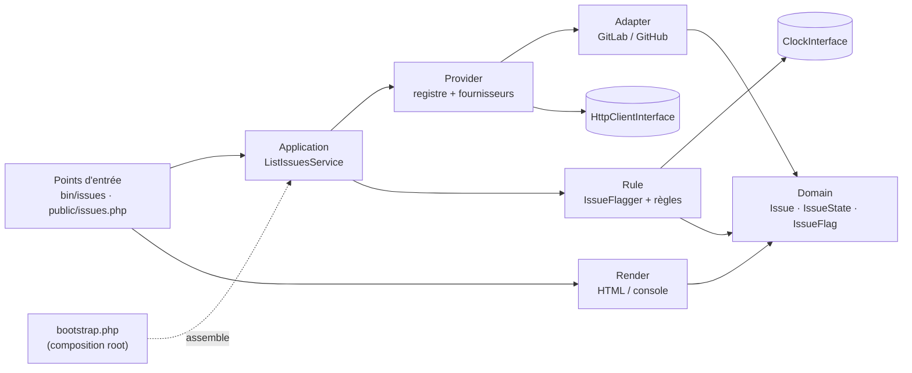

# Cours : passer d'un code qui marche à un code qui évolue

> Synthèse du TP Infal144 « Optimisation Développement » (CESI).
> Fil rouge : un programme qui liste les issues GitLab ou GitHub.
> Ce document sert à **réappliquer la démarche** sur n'importe quel projet du même type : un programme qui interroge une ou plusieurs sources externes, applique des règles métier et affiche un résultat.

## Sommaire

1. [Ce que le TP enseigne](#1-ce-que-le-tp-enseigne)
2. [Diagnostiquer un code : la grille de lecture](#2-diagnostiquer-un-code--la-grille-de-lecture)
3. [Les cinq principes SOLID](#3-les-cinq-principes-solid)
4. [Au-delà de SOLID : les règles d'hygiène](#4-au-delà-de-solid--les-règles-dhygiène)
5. [Les patterns de conception utilisés](#5-les-patterns-de-conception-utilisés)
6. [L'architecture type](#6-larchitecture-type)
7. [Gérer les erreurs](#7-gérer-les-erreurs)
8. [Sécurité](#8-sécurité)
9. [Tester sans réseau](#9-tester-sans-réseau)
10. [La démarche pas à pas](#10-la-démarche-pas-à-pas)
11. [Transposer à un autre projet](#11-transposer-à-un-autre-projet)
12. [Compromis : ne pas sur-concevoir](#12-compromis--ne-pas-sur-concevoir)
13. [Checklists](#13-checklists)
14. [L'essentiel en 12 règles](#14-lessentiel-en-12-règles)
15. [Glossaire](#15-glossaire)
16. [Pour aller plus loin](#16-pour-aller-plus-loin)

---

## 1. Ce que le TP enseigne

Le TP met côte à côte deux programmes qui font **exactement la même chose** :

| | [app/bad-design/issues.php](app/bad-design/issues.php) | [app/src/](app/src/) |
|---|---|---|
| Taille | 158 lignes, un seul fichier procédural | 26 fichiers (classes, interfaces, enums) |
| Fonctionne ? | Oui | Oui |
| Tests | Aucun (impossible sans réseau) | 17 classes de test, 88 tests, aucun accès réseau |
| Ajouter Jira | Rouvrir le `if/elseif`, copier-coller 50 lignes, retoucher le rendu | 1 config, 1 fournisseur, 1 adaptateur, **1 ligne** dans `bootstrap.php`. Aucune classe existante modifiée |

**La leçon centrale : un code qui marche n'est pas un code terminé.** La qualité d'un code se mesure au **coût du prochain changement** : ajouter une source, modifier une règle, changer d'affichage, corriger un bug, tester.

Le critère concret du TP est **« ajouter Jira sans modifier l'existant »**. C'est le test à retenir pour vos propres projets : *si ajouter une variante m'oblige à rouvrir du code qui marche, la conception n'est pas finie.*

Les six compétences visées :

1. **Diagnostiquer** : lire un code et nommer ses défauts avec le bon vocabulaire.
2. **Découper** : une responsabilité par classe.
3. **Abstraire aux bons endroits** : des interfaces là où le comportement varie (la source, la règle, le format de sortie), et nulle part ailleurs.
4. **Inverser les dépendances** : injecter le réseau, l'horloge et la configuration, pour pouvoir les remplacer en test.
5. **Échouer proprement** : erreurs typées, messages utiles, codes de sortie maîtrisés.
6. **Prouver** : des tests rapides, sans réseau, qui verrouillent le comportement et la sécurité.

---

## 2. Diagnostiquer un code : la grille de lecture

Avant de toucher au code, on fait l'**inventaire des défauts**. Lisez le code avec chacune de ces lentilles et notez ce que vous trouvez.

| Lentille | Question à se poser | Symptômes typiques | Dans le TP |
|---|---|---|---|
| **Responsabilités** (SRP) | Combien de raisons ce fichier a-t-il de changer ? | Config, HTTP, parsing, règles et affichage dans le même fichier | Tout `issues.php` |
| **Extension** (OCP) | Pour ajouter une variante, dois-je modifier du code existant ? | `if/elseif` ou `switch` sur un type ou un nom ; code mort `// TODO plus tard` | `if ($provider == 'gitlab') … elseif ('github')` |
| **Contrats** (LSP, ISP) | Les variantes renvoient-elles la même chose ? Qui dépend de quoi ? | Tableaux associatifs construits à la main, différemment dans chaque branche | Le tableau `$a` « fourre-tout » |
| **Dépendances** (DIP) | Puis-je tester ce code sans réseau, sans horloge, sans base ? | `curl_*`, `time()`, `$_GET`, `getenv()` appelés au milieu de la logique | `curl_exec`, `time()` dans `d()` |
| **Duplication** (DRY) | Le même savoir est-il écrit deux fois ? | Blocs copiés-collés entre branches | Pagination, labels, URGENT copiés entre GitLab et GitHub |
| **Lisibilité** | Un nouveau venu comprend-il sans demander ? | `$a`, `$r`, `$tmp`, `d()` ; `30`, `100`, `50` en dur ; `global` ; code mort | Partout |
| **Sécurité** | Que se passe-t-il si une donnée est hostile ? | Secrets en dur, jeton dans l'URL, TLS désactivé, sortie non échappée, entrée non validée | Les cinq sont présents |
| **Robustesse** | Que se passe-t-il quand ça échoue ? | `error_reporting(0)`, `@`, `die('erreur')`, pas de timeout, codes HTTP ignorés, limite silencieuse | Les six sont présents |

**Livrable du diagnostic** : un tableau `défaut → emplacement → principe violé → correction envisagée`. C'est exactement la forme de [app/bad-design/CORRIGE.md](app/bad-design/CORRIGE.md).

**Ordre de traitement conseillé** : sécurité, puis robustesse, puis conception, puis lisibilité. Une faille XSS est plus urgente qu'une variable mal nommée.

---

## 3. Les cinq principes SOLID

Pour chaque principe : la définition, le symptôme, la question qui permet de le détecter, l'avant/après tiré du TP, et le réflexe à retenir.

### S : Single Responsibility (responsabilité unique)

**Définition.** Une classe n'a qu'**une seule raison de changer**. Ce n'est pas « une seule méthode » : c'est un seul *sujet*, une seule source de changement.

**Symptôme.** Un fichier qui mélange configuration, accès réseau, transformation de données, règles métier et affichage.

**Le test pratique : la table des raisons de changer.** Pour chaque changement imaginable, combien de fichiers dois-je toucher ? La bonne réponse est « un seul ».

| Si ceci change… | Dans `issues.php` | Dans la version SOLID |
|---|---|---|
| Le format JSON de GitLab | Le fichier entier | [GitLabIssueAdapter.php](app/src/Adapter/GitLabIssueAdapter.php) |
| L'URL ou l'authentification de GitHub | Le fichier entier | [GitHubIssueProvider.php](app/src/Provider/GitHubIssueProvider.php) |
| Le seuil « STALE » (30 jours) | Le fichier entier | Un paramètre de [StaleRule.php](app/src/Rule/StaleRule.php) dans `bootstrap.php` |
| L'affichage HTML | Le fichier entier | [HtmlRenderer.php](app/src/Render/HtmlRenderer.php) |
| La pagination | Deux endroits (copiés-collés) | [AbstractPaginatedProvider.php](app/src/Provider/AbstractPaginatedProvider.php) |
| Les variables d'environnement | Le haut du fichier | [app/src/Config/](app/src/Config/) |

**Réflexe.** Pour chaque classe, savoir finir la phrase « cette classe change si et seulement si… ».

### O : Open/Closed (ouvert à l'extension, fermé à la modification)

**Définition.** On ajoute un comportement en **ajoutant du code**, pas en modifiant du code qui marche.

**Symptôme.** Un `if/elseif` ou un `switch` sur un type, un nom ou un code, qui grandit à chaque nouvelle variante.

**Avant** (simplifié) :

```php
if ($provider == 'gitlab') {
    while (true) { /* curl + json + mapping GitLab + règles */ }
} elseif ($provider == 'github') {
    while (true) { /* le même code copié-collé, mapping GitHub */ }
} else {
    die('provider inconnu');
}
// if ($provider == 'jira') { TODO plus tard }
```

**Après** ([ListIssuesService.php](app/src/Application/ListIssuesService.php)) : le choix devient une simple recherche par nom dans un registre.

```php
public function listIssues(string $providerName, IssueState $state): array
{
    $provider = $this->providers->get($providerName); // UnknownProviderException si absent

    $issues = [];
    foreach ($provider->fetchIssues($state) as $issue) {
        $issues[] = $this->flagger->flag($issue);
    }

    return $issues;
}
```

Ajouter Jira, c'est une nouvelle classe et un `register('jira', …)` dans `bootstrap.php`. Le service, le registre, les autres fournisseurs et les rendus ne bougent pas.

**À savoir.** OCP ne veut pas dire « ne jamais rien modifier ». Il reste **un** point de modification assumé : le *composition root* (`bootstrap.php`), où l'on câble les classes entre elles. L'objectif est de concentrer le changement à cet endroit.

**Réflexe.** Un `switch` sur un type est presque toujours une interface qui n'a pas encore été écrite.

### L : Liskov Substitution (substituabilité)

**Définition.** Toute implémentation d'une abstraction peut **remplacer** une autre sans que l'appelant s'en aperçoive. Cela implique le **même type de retour** et la **même sémantique**.

**Symptôme.** L'appelant teste le type concret (`instanceof`, `if ($provider === 'github')`) pour corriger un comportement particulier. Ou une implémentation lève « non supporté » sur une méthode du contrat.

**Exemple du TP.** L'endpoint « issues » de GitHub renvoie aussi les pull requests. Si on les filtrait dans le service (`if github, ignorer les PR`), GitHub ne serait plus substituable à GitLab. On les écarte donc **dans l'adaptateur GitHub**, l'appelant n'en sait rien :

```php
// GitHubIssueAdapter::toIssue()
if (isset($item['pull_request'])) {
    return null; // une bizarrerie de GitHub, réglée chez GitHub
}
```

**Preuve par les tests.** [StubProvider.php](app/tests/Support/StubProvider.php) est un faux fournisseur de quelques lignes. Le service fonctionne avec lui comme avec GitLab ou GitHub : c'est la substituabilité démontrée.

**Réflexe.** Les particularités d'une variante se règlent **dans** la variante, jamais chez l'appelant.

### I : Interface Segregation (interfaces étroites)

**Définition.** Une interface est taillée pour son client : il ne doit pas dépendre de méthodes dont il n'a pas besoin.

**Symptôme.** Une grosse interface que certaines classes implémentent avec des méthodes vides ou `throw new NotImplementedException`. Ou une structure fourre-tout (le tableau `$a`) dont tout le code dépend.

**Dans le TP.** Chaque interface a une méthode, ou deux méthodes sur le même sujet :

```php
interface IssueProviderInterface   { public function fetchIssues(IssueState $state): \Generator; }
interface IssueRuleInterface       { public function evaluate(Issue $issue): ?IssueFlag; }
interface IssueRendererInterface   { public function render(array $issues): string; }
interface IssueAdapterInterface    { public function toIssue(array $item): ?Issue;
                                     public function toApiState(IssueState $state): string; }
```

**Bénéfice concret.** Jira pagine par curseur, pas par numéro de page : il ne rentre pas dans `AbstractPaginatedProvider`. Comme `IssueProviderInterface` n'a qu'une méthode, Jira peut l'implémenter directement, sans rien hériter d'inutile.

**Réflexe.** Plus une interface est petite, plus elle est facile à implémenter, à simuler en test et à réutiliser.

### D : Dependency Inversion (inversion des dépendances)

**Définition.** Le code de haut niveau (le *quoi* : lister des issues) ne dépend pas des détails (le *comment* : cURL, l'horloge système). Les deux dépendent d'**abstractions**.

**Symptôme.** Des appels directs au monde extérieur au milieu de la logique. Conséquence : impossible à tester sans le vrai réseau ou sans attendre 30 jours.

**Avant** :

```php
function d($s) {
    global $cli;                        // inutilisé
    $t = strtotime($s);
    $n = time();                        // horloge système en dur : intestable
    $x = floor(($n - $t) / 86400);
    if ($x > 30) { return 'STALE'; }    // nombre magique, libellé d'affichage
    return '';
}
```

**Après** ([StaleRule.php](app/src/Rule/StaleRule.php)) : l'horloge est **injectée** via l'interface standard PSR-20.

```php
final readonly class StaleRule implements IssueRuleInterface
{
    private const SECONDS_PER_DAY = 86_400;

    public function __construct(
        private ClockInterface $clock,      // NativeClock en prod, MockClock en test
        private int $maxAgeInDays = 30,
    ) {}

    public function evaluate(Issue $issue): ?IssueFlag
    {
        $ageInSeconds = $this->clock->now()->getTimestamp() - $issue->createdAt->getTimestamp();

        return intdiv($ageInSeconds, self::SECONDS_PER_DAY) > $this->maxAgeInDays ? IssueFlag::Stale : null;
    }
}
```

**Les dépendances cachées à traquer** dans n'importe quel projet, et leur abstraction :

| Dépendance cachée | Abstraction à injecter | Double de test |
|---|---|---|
| Réseau (`curl_*`, `file_get_contents(url)`) | `HttpClientInterface` (Symfony Contracts) | `MockHttpClient` |
| Horloge (`time()`, `new DateTime()`) | `ClockInterface` (PSR-20) | `MockClock` |
| Environnement (`getenv`, `$_ENV`) | Un tableau injecté ([Environment.php](app/src/Config/Environment.php)) | Un tableau littéral |
| Entrées (`$_GET`, `$argv`) | Lues **uniquement** dans les points d'entrée, puis passées en paramètre | Appel direct de la méthode |
| Aléatoire, fichiers, base, session, mail | Une interface par besoin | Une implémentation en mémoire |

**Trois notions à ne pas confondre :**

- **DIP** (le principe) : dépendre d'abstractions.
- **Injection de dépendances** (la technique) : recevoir ses collaborateurs par le constructeur au lieu de faire `new` soi-même.
- **Conteneur d'injection** (l'outil) : Symfony `services.yaml`, Laravel, PHP-DI. Il automatise le câblage. Le TP le fait **à la main** dans `bootstrap.php` pour qu'on voie le mécanisme.

**Réflexe.** Aucun `new` d'un service en dehors du composition root. Si une classe fait `new` d'un collaborateur, elle ne peut plus être testée sans lui.

---

## 4. Au-delà de SOLID : les règles d'hygiène

| Règle | Avant | Après | Pourquoi |
|---|---|---|---|
| **DRY** : un savoir, un seul endroit | Pagination copiée dans chaque branche | `AbstractPaginatedProvider` la factorise | Un bug corrigé une fois est corrigé partout |
| **Noms explicites** | `$a`, `$r`, `$tmp`, `d()` | `$issues`, `$response`, `StaleRule::evaluate()` | Le nom dit *ce que c'est*, pas *comment c'est fait* |
| **Pas de nombre magique** | `30`, `100`, `50`, `'bug'` | `PER_PAGE`, `DEFAULT_MAX_PAGES`, `maxAgeInDays: 30`, `label: 'bug'` | Une constante nommée se lit, se cherche et se change |
| **Pas de `global`** | `global $cli` | Paramètres de constructeur | L'état partagé crée des dépendances invisibles |
| **Pas de couplage temporel** | `$total++` pendant l'affichage | `count($issues)` | Le total ne dépend plus de l'ordre d'exécution |
| **Pas de code mort** | `// if ($provider == 'jira') TODO` | Supprimé | L'historique, c'est git |
| **Immutabilité** | Tableaux modifiés partout | Classes `readonly`, `DateTimeImmutable`, `withFlags()` qui renvoie une copie | Une règle ne peut pas modifier une issue par effet de bord |
| **Enums pour les ensembles fermés** | `'opened'`, `'open'`, `'STALE'`, `' URGENT'` | `IssueState`, `IssueFlag` | Un état invalide devient **impossible à représenter** |
| **Valeur métier ≠ libellé** | `$flag .= ' URGENT'` (avec un espace en tête) | La règle renvoie `IssueFlag::Urgent`, le rendu décide de l'affichage | Le métier ne connaît pas l'affichage |
| **Valider aux frontières** | `$state` concaténé tel quel dans l'URL | `IssueState::tryFromInput()` dans le point d'entrée ; invariant vérifié dans le constructeur d'`Issue` | Une fois à l'intérieur, la donnée est sûre |
| **Arguments nommés** | Quatre `string` à la suite, permutables sans erreur | `new Issue(id: …, title: …, author: …)` | Le compilateur ne détecte pas deux chaînes inversées, le lecteur oui |
| **Fail fast, fail loud** | `error_reporting(0)` et `@` | Les avertissements PHP deviennent des exceptions | Une erreur cachée est une erreur qui coûte plus cher plus tard |

**Attention au faux DRY.** Deux codes qui se ressemblent ne portent pas forcément le même savoir. Le *mapping* GitLab et le *mapping* GitHub se ressemblent, mais ils changent pour des raisons différentes (chacun suit son API) : ils restent dans deux adaptateurs séparés. Seul ce qui est **vraiment commun** (pagination, gestion des erreurs HTTP) est factorisé.

---

## 5. Les patterns de conception utilisés

Un pattern est une solution connue à un problème récurrent. On ne part pas du pattern : on part du **problème**, et on reconnaît le pattern qui le résout.

| Pattern | Problème résolu | Signe qui doit y faire penser | Dans le TP |
|---|---|---|---|
| **Strategy** | Choisir un comportement parmi plusieurs à l'exécution | Un `if/switch` qui sélectionne un algorithme | Fournisseurs, règles, rendus |
| **Adapter** | Faire parler à une API externe le langage de votre application | Des noms de champs étrangers (`iid`, `html_url`) qui se propagent dans le code | `GitLabIssueAdapter`, `GitHubIssueAdapter` |
| **Template Method** | Plusieurs variantes partagent le même algorithme, seuls quelques détails changent | Deux blocs copiés-collés qui ne diffèrent que par quelques lignes | `AbstractPaginatedProvider` |
| **Registry / Factory** | Obtenir le bon objet à partir d'un nom, à la demande | Un `if ($name == …) new …` | `IssueProviderRegistry` |
| **Facade** | Offrir une porte d'entrée simple devant plusieurs collaborateurs | Les points d'entrée qui orchestrent eux-mêmes plusieurs objets | `ListIssuesService` |
| **Value Object / DTO immuable** | Transporter des données typées, sans effet de bord | Des tableaux associatifs qui circulent partout | `Issue`, `GitLabConfig`, `GitHubConfig` |
| **Composition root** | Assembler l'application en un seul endroit | Des `new` éparpillés dans le code métier | `bootstrap.php` |

### Strategy : une interface, plusieurs implémentations interchangeables

```php
$flagger = new IssueFlagger([
    new StaleRule(new NativeClock()),
    new UrgentRule(),
    // new UnassignedRule(),  ← ajouter une règle = ajouter une ligne
]);
```

`IssueFlagger` boucle sur des `IssueRuleInterface` sans connaître leur contenu. C'est proche d'une chaîne de responsabilités, sauf qu'aucune règle ne court-circuite les autres : toutes s'appliquent.

### Adapter : traduire le vocabulaire d'un outil

Chaque API a son vocabulaire. L'adaptateur est le **seul** endroit qui le connaît :

| | GitLab | GitHub | Modèle commun `Issue` |
|---|---|---|---|
| Identifiant | `iid` | `number` | `id` (string, pour accepter « PROJ-12 » de Jira) |
| Auteur | `author.username` | `user.login` | `author` |
| URL | `web_url` | `html_url` | `url` |
| Labels | `["bug"]` | `[{"name": "bug"}]` | `list<string>` |
| État ouvert | `opened` | `open` | `IssueState::Open` |

L'adaptateur traduit dans **les deux sens** : la réponse vers `Issue` (`toIssue()`), et l'état commun vers le filtre de l'API (`toApiState()`). Il ne connaît ni le HTTP ni le nom du fournisseur : il se teste avec un simple tableau PHP.

### Template Method : factoriser l'algorithme, laisser des « trous »

```php
abstract class AbstractPaginatedProvider implements IssueProviderInterface
{
    final public function fetchIssues(IssueState $state): \Generator   // final : l'algorithme est figé
    {
        for ($page = 1; $page <= $this->maxPages; ++$page) {
            $items = $this->fetchPage($state, $page);   // HTTP, codes d'erreur, JSON : commun
            foreach ($items as $item) {
                $issue = $this->mapSafely($item);       // mapping délégué à l'adaptateur injecté
                if ($issue !== null) { yield $issue; }
            }
            if (count($items) < self::PER_PAGE) { return; }
        }
        throw new ProviderException(/* plafond atteint : on le dit */);
    }

    abstract protected function providerName(): string;   // les « trous » que
    abstract protected function endpoint(): string;       // chaque sous-classe
    abstract protected function headers(): array;         // remplit
}
```

Le corps des sous-classes GitLab et GitHub tient en une trentaine de lignes : un nom, une URL, des en-têtes.

**Composition plutôt qu'héritage.** Le *mapping* est **composé** (un adaptateur injecté) et non hérité : on peut le tester et le remplacer seul. La *pagination* reste héritée : c'est lisible avec deux sous-classes, mais ça couple la base et ses enfants. Refactorer la pagination vers un collaborateur injecté est la suite logique.

### Registry : choisir par nom, instancier à la demande

```php
$providers = (new IssueProviderRegistry())
    ->register('gitlab', static fn () => new GitLabIssueProvider(
        $httpClient, GitLabConfig::fromEnvironment($environment), new GitLabIssueAdapter(),
    ))
    ->register('github', static fn () => new GitHubIssueProvider(
        $httpClient, GitHubConfig::fromEnvironment($environment), new GitHubIssueAdapter(),
    ));
```

On enregistre des **fabriques** (des fonctions), pas des objets. Conséquence : la configuration GitLab n'est lue et validée que si on demande GitLab. Lister GitHub n'exige pas `GITLAB_TOKEN`.

### Value Object / DTO immuable

```php
final readonly class Issue
{
    public function __construct(
        public string $id,
        public string $title,
        public IssueState $state,
        /* … */
        public array $labels,
        public \DateTimeImmutable $createdAt,
        public array $flags = [],
    ) {
        // Invariant vérifié à la construction : protège tous les adaptateurs, y compris futurs.
        if (!array_is_list($labels) || array_filter($labels, fn ($l) => !is_string($l)) !== []) {
            throw new \InvalidArgumentException('Les labels d\'une issue doivent être une liste de chaînes.');
        }
    }

    public function withFlags(IssueFlag ...$flags): self { /* renvoie une COPIE */ }
}
```

Un objet immuable ne peut pas être corrompu par un autre morceau de code, et ses invariants sont garantis dès sa création.

---

## 6. L'architecture type

### Les couches et leurs responsabilités



| Couche | Rôle | Connaît | Ne connaît **pas** |
|---|---|---|---|
| **Domain** | Le vocabulaire commun : `Issue`, `IssueState`, `IssueFlag` | Rien d'autre | HTTP, GitLab, HTML, l'environnement |
| **Adapter** | Traduire le format d'un outil ↔ le domaine | Le domaine | HTTP, le nom du fournisseur |
| **Provider** | Où et comment interroger une API : URL, authentification, pagination, erreurs HTTP | `HttpClientInterface`, l'interface d'adaptateur, sa config | Les règles, l'affichage |
| **Rule** | Les décisions métier (STALE, URGENT) | Le domaine, `ClockInterface` | D'où vient l'issue, comment on l'affiche |
| **Render** | Formater et **échapper** pour un format donné | Le domaine | HTTP, les règles |
| **Application** | Orchestrer un cas d'usage | Les abstractions | Les détails techniques |
| **Config** | Lire l'environnement et produire des objets typés et validés | `Environment` | Le reste |
| **Exception** | Des erreurs typées, une par cause | — | — |
| **bootstrap.php** | Le **seul** endroit qui fait `new` sur les services | Tout | — |
| **Points d'entrée** | Lire l'entrée, valider, appeler, afficher, convertir les erreurs en codes de sortie | Le service, un rendu, les exceptions | Toute logique métier |

**Règle de dépendance.** Les flèches pointent vers le domaine. Le domaine ne dépend de rien. Plus une couche est « technique » (HTTP, HTML, CLI), plus elle est à l'extérieur.

### Le trajet d'une requête

1. Le point d'entrée lit `provider` et `state` (`$argv` ou `$_GET`), valide `state` avec `IssueState::tryFromInput()`.
2. Il charge `bootstrap.php`, qui renvoie un `ListIssuesService` déjà câblé.
3. Le service demande le fournisseur au registre (qui l'instancie à ce moment-là).
4. Le fournisseur interroge l'API page par page et confie chaque élément à son adaptateur, qui renvoie des `Issue`.
5. `IssueFlagger` applique les règles, et chaque `Issue` reçoit ses marqueurs (copie immuable).
6. Le point d'entrée passe la liste au rendu (`ConsoleRenderer` ou `HtmlRenderer`) et affiche le résultat.
7. En cas d'erreur, le point d'entrée attrape l'exception typée et la traduit en code de sortie ou statut HTTP.

### Des points d'entrée fins

Les points d'entrée ([app/bin/issues](app/bin/issues), [app/public/issues.php](app/public/issues.php)) ne contiennent **aucune** logique métier. La CLI et le web partagent 100 % du code ; seuls changent la lecture de l'entrée, le rendu et la traduction des erreurs. Ajouter une API JSON ou une commande Symfony, c'est un troisième point d'entrée fin.

---

## 7. Gérer les erreurs

### Les principes

1. **Ne jamais masquer.** Pas de `@`, pas d'`error_reporting(0)`. Au contraire, `bootstrap.php` transforme les avertissements PHP en exceptions :

   ```php
   set_error_handler(static function (int $severity, string $message, string $file, int $line): bool {
       if (($severity & (E_DEPRECATED | E_USER_DEPRECATED)) !== 0 || (error_reporting() & $severity) === 0) {
           return false;
       }
       throw new \ErrorException($message, 0, $severity, $file, $line);
   });
   ```

   Une clé absente dans une réponse d'API (« Undefined array key ») échoue bruyamment au lieu de produire une ligne vide.

2. **Une exception par cause**, qui porte son contexte :
   - `ConfigurationException` : variable d'environnement manquante, `.env` invalide.
   - `ProviderException` : l'outil distant a échoué. Elle porte le nom du fournisseur, le code HTTP et la cause d'origine (`previous`).
   - `UnknownProviderException` : nom de fournisseur inconnu. Le message liste les noms valides.

3. **Une interface marqueur** (`IssueTrackerException`) que toutes implémentent. Chaque exception garde sa famille SPL (`RuntimeException`, `InvalidArgumentException`), et un seul `catch` attrape « nos » erreurs.

4. **Lever bas, attraper haut.** Les classes lèvent. Seuls les points d'entrée attrapent, du plus précis au plus général, avec un filet `\Throwable` en dernier :

   ```php
   try {
       $service = require __DIR__ . '/../bootstrap.php';
       echo (new ConsoleRenderer())->render($service->listIssues($providerName, $state));
   } catch (UnknownProviderException $e) {   // erreur d'usage
       fwrite(STDERR, 'Erreur : ' . $e->getMessage() . "\n"); exit(2);
   } catch (IssueTrackerException $e) {      // nos erreurs
       fwrite(STDERR, 'Erreur : ' . $e->getMessage() . "\n"); exit(1);
   } catch (\Throwable $e) {                 // bug : jamais de trace brute affichée
       fwrite(STDERR, 'Erreur interne inattendue : ' . get_class($e) . ': ' . $e->getMessage() . "\n"); exit(1);
   }
   ```

5. **Un contrat d'erreurs documenté** :

   | Situation | CLI (code de sortie) | Web (statut HTTP) |
   |---|---|---|
   | Succès | 0 | 200 |
   | État ou fournisseur inconnu (erreur de l'utilisateur) | 2 | 400 |
   | Configuration manquante ou invalide | 1 | 500 |
   | L'outil distant a échoué | 1 | 502 (*Bad Gateway*) |
   | Bug inattendu | 1 | 500 |

6. **Traduire à la frontière.** `AbstractPaginatedProvider::mapSafely()` convertit toute erreur de mapping (clé absente, date invalide, mauvais type) en `ProviderException` avec le nom de l'outil. Le contrat ci-dessus tient même face à des données mal formées.

7. **Des limites explicites** :
   - `timeout` (inactivité) **et** `max_duration` (durée totale) sur chaque requête HTTP.
   - Codes 401, 403, 404, 429 et 5xx convertis en messages clairs (« jeton invalide ou expiré », « vérifiez le nom du projet »…).
   - Le plafond de pages **lève une erreur** au lieu de tronquer la liste en silence.

8. **Des messages actionnables.** Comparez :
   - `provider inconnu` → `Fournisseur inconnu « jira ». Fournisseurs disponibles : gitlab, github.`
   - `erreur` → `Variable d'environnement manquante ou vide : GITLAB_TOKEN (voir .env.example).`

9. **Afficher peu, journaliser tout.** Côté web, l'utilisateur voit un message générique ; l'exception complète (cause et trace) part dans les journaux avec `error_log((string) $exception)`.

**Piège à connaître.** `fetchIssues()` renvoie un `Generator`, qui est **paresseux** : les erreurs sont levées pendant le `foreach`, pas à l'appel de la méthode. Le `try` doit englober l'itération.

---

## 8. Sécurité

**Principe général : toute donnée externe est hostile**, qu'elle vienne de l'utilisateur ou d'une API tierce. On **valide en entrée** et on **échappe en sortie**.

| Faille | Mauvais | Bon | Règle à retenir |
|---|---|---|---|
| **Secrets en dur** | `$gitlab_token = 'glpat-…'` dans le code | `.env` ignoré par git, `.env.example` versionné sans valeurs | Un jeton commité est un jeton compromis : on le révoque |
| **Jeton dans l'URL** | `?private_token=…`, `?access_token=…` | En-tête `Authorization: Bearer …` | Les URLs finissent dans les logs, l'historique et les proxys |
| **TLS désactivé** | `CURLOPT_SSL_VERIFYPEER => false` | Vérification active (par défaut) | Sans vérification, n'importe qui peut s'interposer |
| **XSS** | `echo '<td>' . $x['title'] . '</td>'` | `htmlspecialchars($text, ENT_QUOTES \| ENT_SUBSTITUTE, 'UTF-8')` | Échapper à la **sortie**, dans **un seul** endroit, selon le **format** |
| **Schéma d'URL dangereux** | `'<a href="' . $url . '">'` | Lien créé seulement si le schéma est `http` ou `https` | `htmlspecialchars` n'empêche pas `javascript:` |
| **Injection de paramètre** | `$state` concaténé dans l'URL de l'API | Liste blanche via l'enum (`tryFromInput`), sinon 400 | Valider avant tout usage |
| **Type d'entrée inattendu** | `$_GET['state']` supposé être une chaîne | `is_string($_GET['state'] ?? null)` | `?state[]=x` produit un tableau |
| **Fuite d'information** | Message d'erreur technique affiché au navigateur | Page générique, détail dans les journaux | Ne jamais exposer chemins, URLs internes ou contenu du `.env` |

**Un détail qui montre le niveau d'exigence.** Le TP utilise `Authorization: Bearer` pour GitLab plutôt que l'en-tête `PRIVATE-TOKEN`. Raison : en cas de redirection vers un autre hôte, Symfony HttpClient retire automatiquement l'en-tête `Authorization`, mais pas un en-tête personnalisé.

**Chaque rendu est responsable de la sécurité de son format.** `HtmlRenderer` échappe pour le HTML ; `ConsoleRenderer` n'échappe pas, car un terminal n'est pas du HTML. Un futur `CsvRenderer` devra se protéger de l'injection de formules (cellules commençant par `=`).

**Les invariants de sécurité se testent** : le test GitLab vérifie que le jeton n'apparaît jamais dans l'URL.

```php
self::assertSame('Bearer ' . self::TOKEN, FakeHttp::header($requests[0]['options'], 'Authorization'));
self::assertStringNotContainsString(self::TOKEN, $requests[0]['url'], 'Le jeton ne doit jamais apparaître dans l\'URL');
```

---

## 9. Tester sans réseau

### Le DIP rend le code testable

Chaque dépendance injectée peut être remplacée par un **double de test** :

| Ce qu'on teste | Le double | Fichier |
|---|---|---|
| Un fournisseur (URL, en-têtes, pagination, erreurs HTTP) | `MockHttpClient`, qui rejoue des réponses préparées et enregistre les requêtes | [FakeHttp.php](app/tests/Support/FakeHttp.php) |
| Une règle de temps | `MockClock`, qui fige l'heure | [StaleRuleTest.php](app/tests/Rule/StaleRuleTest.php) |
| Le service applicatif | `StubProvider`, un faux fournisseur d'une vingtaine de lignes | [StubProvider.php](app/tests/Support/StubProvider.php) |
| La base paginée, une seule fois pour tous les fournisseurs | `FakePaginatedProvider` + `FakeIssueAdapter` | [app/tests/Support/](app/tests/Support/) |
| Un adaptateur | Rien : un simple tableau PHP en entrée | [GitLabIssueAdapterTest.php](app/tests/Adapter/GitLabIssueAdapterTest.php) |

### Les bonnes pratiques illustrées

- **Une fabrique de test avec des valeurs par défaut** ([IssueFactory.php](app/tests/Support/IssueFactory.php)) : chaque test ne précise que ce qui l'intéresse.

  ```php
  IssueFactory::create(labels: ['bug']);           // le reste a une valeur par défaut
  ```

- **Les cas limites avec un DataProvider** : 0 jour, 29 jours, exactement 30 jours, 30 jours et 23 h 59, 31 jours.

  ```php
  #[DataProvider('ages')]
  public function testFlagsIssuesOlderThanThirtyWholeDays(int $ageInSeconds, ?IssueFlag $expected): void
  {
      $now = new \DateTimeImmutable('2026-10-30T12:00:00+00:00');
      $rule = new StaleRule(new MockClock($now));
      $issue = IssueFactory::create(createdAt: $now->modify(sprintf('-%d seconds', $ageInSeconds)));

      self::assertSame($expected, $rule->evaluate($issue));
  }
  ```

- **Tester le comportement, pas l'implémentation** : le mapping champ par champ est testé dans le test de l'adaptateur ; le test du fournisseur vérifie seulement que le câblage fonctionne de bout en bout.
- **Tester les chemins d'erreur** : état inconnu, date invalide, champ mal typé, labels mal formés, chacun doit produire une `ProviderException`.
- **Tester la sécurité** : jeton absent de l'URL, échappement HTML, refus des liens `javascript:`.
- **PHPUnit strict** : `failOnWarning` et `failOnRisky` dans [phpunit.xml](app/phpunit.xml).
- **Un faux serveur d'API pour la démo** ([fake_api_server.php](app/tests/Support/fake_api_server.php)) : on montre le programme en marche sans jeton, et même une réponse volontairement cassée (`GITLAB_PROJECT=demo/broken`).

```bash
docker-compose exec app vendor/bin/phpunit     # toute la suite, sans réseau
```

---

## 10. La démarche pas à pas

La recette à suivre pour refactorer un autre projet du même type.

**Étape 0. Comprendre et figer le comportement actuel.**
Faire tourner le code existant, noter ses sorties. Idéalement, écrire des *tests de caractérisation* ou un faux serveur qui capturent ce qu'il fait aujourd'hui. Lister les changements de comportement **assumés** et les documenter. Exemple du TP : URGENT passe d'un `strpos($labels, 'bug')`, qui marquait aussi « debugging », à une comparaison exacte. En contrepartie, le label scopé GitLab `type::bug` n'est plus reconnu.

**Étape 1. Faire l'inventaire des défauts** avec la grille du [§ 2](#2-diagnostiquer-un-code--la-grille-de-lecture).

**Étape 2. Extraire le modèle commun.** Quel est le vocabulaire de *votre* application, indépendant de toute source ? Un objet immuable (`Issue`) et des enums pour les ensembles fermés (`IssueState`, `IssueFlag`).

**Étape 3. Repérer les axes de variation.** Qu'est-ce qui change d'une variante à l'autre ? Dans le TP, trois axes : la **source** (GitLab, GitHub, Jira), la **règle** (STALE, URGENT), le **format de sortie** (HTML, console). Écrire une interface étroite par axe.

**Étape 4. Séparer « interroger » de « traduire ».** Le fournisseur sait où et comment appeler l'API ; l'adaptateur sait traduire sa réponse. Deux raisons de changer, deux classes.

**Étape 5. Factoriser ce qui est vraiment commun** (pagination, gestion des erreurs HTTP, timeouts) dans une classe de base ou un collaborateur injecté.

**Étape 6. Sortir les règles métier** dans des classes, avec des paramètres au lieu de nombres magiques.

**Étape 7. Sortir le rendu**, une classe par format, avec l'échappement adapté au format.

**Étape 8. Sortir la configuration** : variables d'environnement → objets de configuration typés et validés, une configuration par source.

**Étape 9. Remplacer `die`, `@` et les erreurs silencieuses** par des exceptions typées. Écrire des points d'entrée fins qui les traduisent en codes de sortie et en statuts HTTP.

**Étape 10. Tout câbler dans un composition root.**

**Étape 11. Écrire les tests**, sans réseau, sans horloge réelle, sans environnement réel.

**Étape 12. Passer le test d'extension.** Écrire, ou au moins dérouler sur papier, l'ajout d'une nouvelle variante. Si cela demande de modifier une classe existante, revenir à l'étape 3.

**Étape 13. Documenter** : un README avec comment lancer, l'architecture, un tableau avant/après principe par principe, un guide « ajouter X en N étapes », et les limites connues. Modèle : [app/README.md](app/README.md).

**Conseils de méthode :**

- Avancer **par petits pas**, tests verts entre chaque étape, un commit par étape.
- Ne pas tout refaire d'un coup : extraire une classe, la brancher, vérifier, recommencer.
- Chaque classe peut porter en commentaire le défaut qu'elle corrige : c'est ce que fait le TP (« Corrige : … » dans chaque docblock), et c'est un excellent support de soutenance.

### Le test d'extension : « ajouter Jira en 4 étapes »

C'est la preuve finale de la conception. Dans le TP :

1. Une configuration : `JiraConfig::fromEnvironment()`.
2. Un fournisseur (`JiraIssueProvider implements IssueProviderInterface`, qui gère sa propre pagination par curseur) et un adaptateur (`JiraIssueAdapter implements IssueAdapterInterface`).
3. Un `->register('jira', …)` dans `bootstrap.php`.
4. Les tests (`JiraIssueAdapterTest` pur, `JiraIssueProviderTest` avec `FakeHttp`) et les variables `JIRA_*` dans `.env.example`.

Les règles, les rendus, le registre et les points d'entrée fonctionnent immédiatement avec Jira : ils ne connaissent que `IssueProviderInterface` et `Issue`. Le détail est dans [app/README.md](app/README.md#ajouter-jira-en-4-étapes).

---

## 11. Transposer à un autre projet

### Le squelette réutilisable

La structure du TP s'applique dès qu'un projet a cette forme :

> **N sources externes hétérogènes** → **un modèle commun** → **des règles** → **M formats de sortie**

| Projet | Modèle commun | Sources (Provider + Adapter) | Règles | Rendus |
|---|---|---|---|---|
| Agrégateur météo | `Forecast` | Plusieurs API météo | Alerte gel, alerte canicule | HTML, CLI, JSON |
| Paiement | `Payment`, `PaymentResult` | Plusieurs prestataires de paiement | Plafond, anti-fraude | Reçu HTML, PDF |
| Notifications | `Message` | — (ici ce sont les **sorties** qui varient) | Heures silencieuses | E-mail, SMS, Slack |
| Offres d'emploi | `JobOffer` | Plusieurs sites d'offres | Salaire minimum, distance | Liste HTML, alerte e-mail |
| Suivi de CI | `Pipeline` | GitLab CI, GitHub Actions | « En échec plus de 3 fois » | Tableau de bord, CLI |
| Export de données | `Report` | Base de données, API | — | CSV, PDF, tableur |
| Stockage de fichiers | `StoredFile` | Disque local, stockage objet cloud | Taille maximale, types autorisés | — |

### La fiche de transposition

Remplissez ce tableau pour votre projet avant d'écrire du code :

| Concept | Dans le TP | Dans votre projet |
|---|---|---|
| Modèle commun (objet immuable) | `Issue` | |
| Ensembles fermés (enums) | `IssueState`, `IssueFlag` | |
| Contrat de source | `IssueProviderInterface::fetchIssues()` | |
| Traduction de format | `IssueAdapterInterface::toIssue()` | |
| Algorithme commun factorisé | `AbstractPaginatedProvider` | |
| Choix par nom | `IssueProviderRegistry` | |
| Règle métier | `IssueRuleInterface::evaluate()` | |
| Format de sortie | `IssueRendererInterface::render()` | |
| Cas d'usage (façade) | `ListIssuesService::listIssues()` | |
| Configuration typée | `GitLabConfig::fromEnvironment()` | |
| Erreurs typées | `ConfigurationException`, `ProviderException`, `UnknownProviderException` | |
| Dépendances externes injectées | `HttpClientInterface`, `ClockInterface` | |
| Composition root | `bootstrap.php` | |
| Test d'extension | « Ajouter Jira » | « Ajouter … » |

### Les équivalents dans d'autres langages

| Notion | PHP (le TP) | Java | C# / .NET | TypeScript | Python |
|---|---|---|---|---|---|
| Contrat | `interface` | `interface` | `interface` | `interface` | `Protocol` ou `ABC` |
| Ensemble fermé | `enum` | `enum` | `enum` | union de littéraux ou `enum` | `Enum` |
| Objet immuable | `readonly class` | `record` | `record` | `readonly`, `Readonly<T>` | `@dataclass(frozen=True)` |
| Conteneur d'injection | Symfony, Laravel, PHP-DI | Spring | `Microsoft.Extensions.DependencyInjection` | NestJS, InversifyJS (ou à la main) | À la main, ou `dependency-injector` |
| Faux HTTP | `MockHttpClient` | WireMock, MockWebServer | `HttpMessageHandler` simulé | msw, nock | responses, respx |
| Horloge injectable | PSR-20 `ClockInterface` | `java.time.Clock` | `TimeProvider` (.NET 8) | Faux timers (Jest, Vitest) | freezegun, ou horloge injectée |

Les principes ne dépendent pas du langage : seule la syntaxe change.

---

## 12. Compromis : ne pas sur-concevoir

Passer de 158 lignes à 26 fichiers a un coût. Ce coût se justifie quand :

- les variantes vont se multiplier (un 3ᵉ outil, un 3ᵉ format) ;
- le code vivra longtemps et sera relu par d'autres ;
- il faut des tests fiables ;
- les erreurs ont un coût (production, données d'utilisateurs, sécurité).

Pour un script jetable lancé une seule fois, c'est trop. **Règle de trois** : on peut dupliquer une fois ; à la troisième occurrence, on abstrait.

Les compromis assumés par le TP, à savoir défendre en soutenance :

| Choix | Avantage | Limite | Évolution possible |
|---|---|---|---|
| Template Method pour la pagination | Très lisible avec 2 sous-classes | Héritage = couplage fort ; Jira n'entre pas dans le moule | Injecter un collaborateur de pagination |
| Câblage à la main dans `bootstrap.php` | Le mécanisme est visible | Ne passe pas à l'échelle | Conteneur d'injection |
| Registre de fabriques | Simple, instanciation paresseuse | Ressemble à un *Service Locator* | Conteneur d'injection |
| `IssueState::All` dans l'enum des états | Simple (YAGNI) | « Tous » est un filtre, pas un état | Séparer état et filtre si les filtres se multiplient |
| `catch (\Throwable)` dans `mapSafely()` | Message propre, code de sortie maîtrisé | Un vrai bug d'adaptateur passe pour une « réponse inattendue » | La cause reste chaînée et journalisée |
| `set_error_handler` global | Les données inattendues échouent proprement | Effet global | Le gestionnaire d'erreurs d'un framework |
| Pas de cache | Simple | Chaque exécution interroge les API | Un décorateur `CachedIssueProvider` autour d'`IssueProviderInterface` |

**Savoir nommer les limites de sa propre conception** fait partie de la compétence : ce n'est pas un aveu de faiblesse.

---

## 13. Checklists

### Conception

- [ ] Pour chaque classe, je sais finir la phrase « elle change si et seulement si… ».
- [ ] Ajouter une variante = de nouvelles classes + une ligne de câblage, sans modifier l'existant.
- [ ] Aucun `if/switch` sur un type ou un nom de variante dans le code métier.
- [ ] Aucun `new` d'un service en dehors du composition root.
- [ ] Aucun appel direct au réseau, à l'horloge, à l'environnement ou aux superglobales dans la logique.
- [ ] Les interfaces ont une ou deux méthodes cohésives.
- [ ] Toutes les implémentations d'une interface renvoient le même type, avec la même sémantique.
- [ ] Les particularités d'une source sont réglées dans son adaptateur.
- [ ] Les objets de données sont immuables et valident leurs invariants à la construction.
- [ ] Les ensembles fermés sont des enums.

### Lisibilité

- [ ] Aucun nom d'une lettre ou d'abréviation obscure.
- [ ] Aucun nombre ou chaîne magique : constantes nommées ou paramètres.
- [ ] Aucune variable globale, aucun code mort commenté.
- [ ] Arguments nommés quand plusieurs paramètres ont le même type.

### Sécurité

- [ ] Aucun secret dans le code ; `.env` ignoré par git ; `.env.example` versionné.
- [ ] Jetons dans les en-têtes, jamais dans les URLs.
- [ ] TLS vérifié.
- [ ] Toute sortie HTML échappée, en un seul endroit.
- [ ] Les URLs externes ne deviennent des liens que si le schéma est `http` ou `https`.
- [ ] Toute entrée validée contre une liste blanche, y compris son type.
- [ ] Les messages d'erreur affichés n'exposent ni chemin, ni URL interne, ni secret.

### Robustesse

- [ ] Ni `@`, ni `error_reporting(0)`, ni `die()`.
- [ ] Des exceptions typées par cause, avec la cause d'origine chaînée.
- [ ] Les exceptions ne sont attrapées que dans les points d'entrée, du plus précis au plus général.
- [ ] Un contrat documenté : codes de sortie et statuts HTTP.
- [ ] Timeouts sur tout appel réseau ; codes HTTP vérifiés.
- [ ] Aucune limite silencieuse : si un plafond est atteint, on le signale.
- [ ] Des messages d'erreur actionnables (que faire pour corriger ?).

### Tests

- [ ] La suite tourne sans réseau, sans horloge réelle, sans environnement réel.
- [ ] Les cas limites sont couverts (bornes, valeurs vides, formats inattendus).
- [ ] Les chemins d'erreur sont testés, pas seulement le cas nominal.
- [ ] Les invariants de sécurité sont testés.
- [ ] Une fabrique de test évite de répéter les constructeurs.

### Livrable

- [ ] README : lancer le projet, architecture, avant/après, « ajouter X en N étapes », limites.
- [ ] `.env.example` à jour.
- [ ] La suite de tests passe.
- [ ] Une démo hors ligne est possible (faux serveur ou données d'exemple).

---

## 14. L'essentiel en 12 règles

1. **Un code qui marche n'est pas un code fini** : la qualité, c'est le coût du prochain changement.
2. **Diagnostiquer avant de refactorer** : inventaire des défauts, classés par gravité.
3. **Une classe, une raison de changer.**
4. **Un `switch` sur un type, c'est une interface qui manque.**
5. **Les particularités d'une variante restent dans la variante.**
6. **Des interfaces petites**, taillées pour leur client.
7. **Injecter tout ce qui touche le monde extérieur** : réseau, horloge, environnement.
8. **Un seul endroit fait les `new`** : le composition root.
9. **Valider en entrée, échapper en sortie**, et toute donnée externe est hostile.
10. **Échouer tôt, bruyamment et avec un message utile**, jamais en silence.
11. **Tester sans réseau**, y compris les erreurs et la sécurité.
12. **Prouver la conception par le test d'extension** : ajouter une variante sans toucher l'existant.

---

## 15. Glossaire

| Terme | Définition |
|---|---|
| **SOLID** | Cinq principes de conception orientée objet : SRP, OCP, LSP, ISP, DIP. |
| **SRP** | *Single Responsibility* : une seule raison de changer. |
| **OCP** | *Open/Closed* : ouvert à l'extension, fermé à la modification. |
| **LSP** | *Liskov Substitution* : une implémentation peut en remplacer une autre sans surprise. |
| **ISP** | *Interface Segregation* : des interfaces étroites, taillées pour leur client. |
| **DIP** | *Dependency Inversion* : dépendre d'abstractions, pas de détails. |
| **Injection de dépendances** | Recevoir ses collaborateurs (par le constructeur) au lieu de les créer. |
| **Composition root** | L'unique endroit où l'application est assemblée (`bootstrap.php`). |
| **Couplage** | Degré de dépendance entre deux éléments. On le veut faible. |
| **Cohésion** | Degré auquel les éléments d'une classe servent le même but. On la veut forte. |
| **Couplage temporel** | Un résultat qui dépend de l'ordre d'exécution (`$total++` pendant l'affichage). |
| **DTO** | *Data Transfer Object* : objet qui transporte des données, sans comportement métier. |
| **Value Object** | Objet immuable défini par ses valeurs (deux objets aux mêmes valeurs sont égaux). |
| **Invariant** | Condition toujours vraie pour un objet valide, vérifiée à sa construction. |
| **Strategy** | Une interface, plusieurs algorithmes interchangeables. |
| **Adapter** | Traduit l'interface d'un système vers celle qu'attend l'application. |
| **Template Method** | Une méthode de base fixe l'algorithme ; les sous-classes remplissent des étapes. |
| **Facade** | Une interface simple devant un ensemble de collaborateurs. |
| **Registry** | Catalogue d'objets ou de fabriques indexés par nom. |
| **Service Locator** | Objet global auquel on demande ses dépendances. Considéré comme un anti-pattern quand il remplace l'injection. |
| **Double de test** | Objet qui remplace une dépendance en test : *stub* (réponses préparées), *mock* (vérifie les appels), *fake* (implémentation simplifiée). |
| **Test de caractérisation** | Test qui capture le comportement actuel d'un code existant avant de le modifier. |
| **Generator** | Fonction qui produit ses valeurs une à une (`yield`), de façon paresseuse. |
| **Fail fast** | Échouer dès qu'une anomalie est détectée, plutôt que de continuer avec des données fausses. |
| **DRY** | *Don't Repeat Yourself* : un savoir, un seul endroit. |
| **YAGNI** | *You Aren't Gonna Need It* : ne pas coder ce dont on n'a pas encore besoin. |
| **KISS** | *Keep It Simple, Stupid* : la solution la plus simple qui fonctionne. |
| **XSS** | *Cross-Site Scripting* : injection de script dans une page par une donnée non échappée. |
| **PSR-20** | Standard PHP qui définit `ClockInterface`, une horloge injectable. |

---

## 16. Pour aller plus loin

**Dans ce dépôt :**

- [app/README.md](app/README.md) : architecture complète (diagramme de classes), avant/après, guide Jira, limites.
- [app/bad-design/issues.php](app/bad-design/issues.php) et [app/bad-design/CORRIGE.md](app/bad-design/CORRIGE.md) : le point de départ et l'inventaire des défauts.
- Les docblocks de [app/src/](app/src/) : chaque classe indique son rôle, ses principes, son pattern et le défaut qu'elle corrige.
- [app/tests/](app/tests/) : des exemples de tests à réutiliser.

**Références :**

- [Catalogue des design patterns (refactoring.guru)](https://refactoring.guru/fr/design-patterns/catalog)
- [SOLID (Wikipédia)](https://fr.wikipedia.org/wiki/SOLID_(informatique))
- [Value Object (Martin Fowler)](https://martinfowler.com/bliki/ValueObject.html) et [Registry (Martin Fowler)](https://martinfowler.com/eaaCatalog/registry.html)
- [PSR-20 : Clock](https://www.php-fig.org/psr/psr-20/)
- [OWASP : prévention des XSS](https://cheatsheetseries.owasp.org/cheatsheets/Cross_Site_Scripting_Prevention_Cheat_Sheet.html)

**Livres :**

- Robert C. Martin, *Clean Code* et *Clean Architecture*.
- Martin Fowler, *Refactoring*.
- Michael Feathers, *Working Effectively with Legacy Code* (tests de caractérisation, refactoring d'un code existant sans tests).
