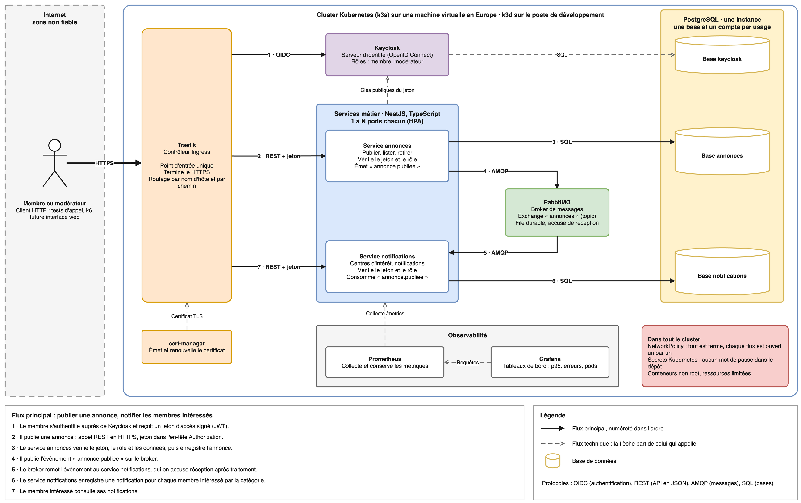

# Étape 3 — Architecture technique

- Date : 12 novembre 2026
- Statut : validé le 13 novembre 2026
- Complète : [exigences et backlog](03-exigences-et-backlog.md)
- Schéma : [architecture technique](schemas/architecture-technique.md)

## 1. Objet

Ce document décrit l'architecture du prototype : ses composants, leurs échanges, la sécurité, et les choix de technologies. Chaque choix renvoie à une fiche de décision, qui cite l'alternative écartée.

Rien n'est encore déployé. Les chiffres de mémoire et de délai sont des ordres de grandeur, à mesurer à l'étape 4.

## 2. Vue d'ensemble



Le prototype est une architecture en services, pilotée par événements : chaque service possède ses données, et les services ne se parlent que par des messages.

| Principe | Application |
|---|---|
| Un service, une responsabilité | « annonces » gère les annonces ; « notifications » gère les centres d'intérêt et les notifications |
| Chaque service possède ses données | Une base et un compte par service. Aucun service ne lit la base de l'autre |
| Communication asynchrone entre services | « annonces » émet un événement ; « notifications » le consomme. Aucun appel direct |
| Un seul point d'entrée | Tout le trafic externe passe par l'Ingress, en HTTPS |
| Ne faire confiance à aucune requête | Chaque service vérifie lui-même le jeton et le rôle |

## 3. Choix structurants

| Sujet | Choix | Fiche | Principale alternative écartée |
|---|---|---|---|
| Langage et framework | TypeScript, NestJS | [0002](adr/0002-stack-back-end.md) | Java, Spring Boot |
| Hébergement et orchestration | Kubernetes : k3d en local, k3s sur une machine virtuelle en Europe | [0003](adr/0003-hebergement-et-orchestration.md) | Docker Compose |
| Communication entre services | Événements par RabbitMQ, protocole AMQP | [0007](adr/0007-broker-de-messages.md) | Appel HTTP direct |
| Base de données | PostgreSQL, une instance, une base par service ; TypeORM | [0008](adr/0008-persistance.md) | Une instance par service |
| Authentification et autorisation | Keycloak, OpenID Connect, jeton vérifié dans chaque service | [0009](adr/0009-authentification-et-autorisation.md) | Authentification écrite dans les services |
| Exposition | API REST en HTTPS, Ingress Traefik, cert-manager | [0010](adr/0010-exposition-et-https.md) | Un point d'entrée par service |
| Observabilité | Métriques : Prometheus et Grafana | [0011](adr/0011-observabilite.md) | Logs centralisés |

## 4. Composants

| Composant | Rôle | Technologie | Dans le cluster |
|---|---|---|---|
| Point d'entrée | Reçoit tout le trafic externe, termine le HTTPS, route vers les services | Traefik, contrôleur Ingress fourni par k3s | Ingress |
| Certificats | Émet et renouvelle le certificat TLS | cert-manager | Opérateur |
| Serveur d'identité | Authentifie les utilisateurs, délivre les jetons, porte les rôles | Keycloak | Un pod |
| Service annonces | Publier, lister, retirer une annonce ; émettre l'événement | NestJS | 1 à N pods, sans état |
| Service notifications | Gérer les centres d'intérêt ; consommer l'événement ; exposer les notifications | NestJS | 1 à N pods, sans état |
| Broker de messages | Reçoit les événements et les remet aux services abonnés | RabbitMQ | Un nœud, avec stockage |
| Bases de données | Stockent les annonces, les notifications, les données de Keycloak | PostgreSQL | Une instance, avec stockage |
| Métriques | Collecte, conserve et affiche les métriques | Prometheus, Grafana | Pile installée par Helm |

« Sans état » : le service ne garde rien en mémoire entre deux requêtes. N'importe quel pod peut traiter n'importe quelle requête, ce qui permet d'en ajouter ou d'en retirer librement.

Le mode d'installation de chaque composant tiers est fixé à l'étape 4.

## 5. Les deux services

### 5.1 Responsabilités et données

| | Service annonces | Service notifications |
|---|---|---|
| Responsabilité | Le cycle de vie d'une annonce | Les préférences de notification et les notifications |
| Données possédées | Annonces | Centres d'intérêt, notifications |
| Émet | `annonce.publiee` | — |
| Consomme | — | `annonce.publiee` |
| Stories | US-01, US-05, US-06 | US-02, US-03, US-04 |

Les centres d'intérêt sont dans le service notifications : ce sont des réglages de notification (exigence EF-10), et c'est ce service qui en a besoin pour décider qui notifier.

### 5.2 API

| Méthode et chemin | Service | Rôle exigé | Réponse | Story |
|---|---|---|---|---|
| `POST /api/annonces` | annonces | `membre` | 201 | US-01 |
| `GET /api/annonces` | annonces | `membre` ou `moderateur` | 200 | US-05 |
| `DELETE /api/annonces/{id}` | annonces | `moderateur` | 204 | US-06 |
| `PUT /api/centres-interet` | notifications | `membre` | 200 | US-02 |
| `GET /api/centres-interet` | notifications | `membre` | 200 | US-02 |
| `GET /api/notifications` | notifications | `membre` | 200 | US-03 |

`DELETE` ne supprime pas la ligne : l'annonce passe au statut « retirée », pour garder la trace de la modération.

Routes internes, non exposées par l'Ingress : les sondes de santé (le service est-il vivant, est-il prêt) et `/metrics` pour Prometheus.

### 5.3 Structure interne

Les deux services ont la même structure en couches, reprise du cours d'optimisation du développement. La règle : les dépendances pointent vers le domaine, qui ne dépend de rien.

| Couche | Rôle | Ne connaît pas |
|---|---|---|
| Point d'entrée : contrôleur HTTP, consommateur de messages | Lire l'entrée, la valider, appeler le cas d'usage, traduire les erreurs en codes HTTP | La logique métier |
| Application : cas d'usage | Orchestrer : « publier une annonce », « notifier les membres intéressés » | HTTP, SQL, AMQP |
| Domaine | Les règles métier : une annonce valide, la correspondance entre une annonce et un centre d'intérêt | Tout le reste |
| Adaptateurs : dépôt de données, émetteur d'événements | Parler à PostgreSQL et à RabbitMQ, derrière une interface | Les règles métier |

Effet attendu : les règles métier se testent sans base ni broker (tests unitaires), et les adaptateurs se remplacent par des doubles de test.

## 6. Communication

| Échange | Mode | Protocole et format | Pourquoi |
|---|---|---|---|
| Client → services | Synchrone : le client attend la réponse | REST, JSON, sur HTTPS | Simple à appeler, à tester et à mettre sous charge |
| Client → Keycloak | Synchrone | OpenID Connect, sur HTTPS | Standard de l'authentification |
| annonces → notifications | Asynchrone : l'émetteur n'attend pas | Événement JSON, sur AMQP | La publication ne dépend pas du service notifications |
| Services → bases | Synchrone | SQL | — |

### 6.1 Circuit d'un événement

| Élément RabbitMQ | Valeur | Rôle |
|---|---|---|
| Exchange (point d'aiguillage des messages) | `annonces`, de type topic | Reçoit les événements du service annonces et les aiguille selon leur clé de routage |
| Clé de routage | `annonce.publiee` | Dit de quel événement il s'agit |
| File du service notifications | Durable, liée à la clé `annonce.publiee` | Garde les messages tant qu'ils ne sont pas traités |
| File des messages en échec | Reçoit un message que le service a refusé | Évite qu'un message défectueux bloque la file ; permet de l'examiner |

Un nouvel abonné, par exemple un futur service d'enchères, crée sa propre file et la lie à l'exchange. Le service annonces n'est pas modifié.

### 6.2 Contrat de l'événement

```json
{
  "id": "5f0c2a9e-3b7d-4c1a-9e2f-8a6b4d1c7e90",
  "type": "annonce.publiee",
  "version": 1,
  "date": "2027-02-01T10:15:30Z",
  "donnees": {
    "annonceId": "c1d2e3f4-a5b6-4789-8abc-def012345678",
    "titre": "Figurine Evil Ed, édition limitée",
    "categorie": "figurines",
    "typeAnnonce": "don",
    "auteurId": "9a8b7c6d-5e4f-4a3b-8c2d-1e0f9a8b7c6d"
  }
}
```

| Règle | Raison |
|---|---|
| L'événement porte tout ce dont l'abonné a besoin | Le service notifications n'appelle jamais le service annonces |
| Un numéro de version | Le contrat peut évoluer sans casser les abonnés existants |
| Aucune donnée personnelle, sauf l'identifiant technique de l'auteur | Exigence ENF-09 |
| Le contrat est versionné dans le dépôt et vérifié par un test (CA-06) | Un changement involontaire du format casse un test, pas la production |

### 6.3 Garanties de livraison

La livraison est « au moins une fois » : un message n'est jamais perdu une fois accepté par le broker, mais il peut être remis deux fois.

| Mécanisme | Effet |
|---|---|
| File durable et messages persistants | Les messages survivent à un redémarrage du broker |
| Accusé de réception manuel, envoyé après l'enregistrement des notifications | Si le service tombe pendant le traitement, le broker remet le message |
| Contrainte d'unicité (membre, annonce) sur les notifications | Un message remis deux fois ne crée qu'une notification (CA-14). Le traitement est idempotent : le rejouer ne change pas le résultat |
| Plusieurs pods du service notifications sur la même file | Le broker répartit les messages : chaque message est traité par un seul pod |

## 7. Données

### 7.1 Base « annonces »

Table `annonces` :

| Colonne | Type | Rôle |
|---|---|---|
| `id` | UUID, clé primaire | Identifiant de l'annonce |
| `titre`, `description` | Texte | Contenu |
| `categorie` | Texte, liste fermée | Sert à la correspondance avec les centres d'intérêt |
| `type` | `troc` ou `don` | — |
| `statut` | `publiee` ou `retiree` | — |
| `auteur_id` | UUID | Identifiant du membre dans Keycloak |
| `publiee_le` | Date et heure | — |
| `retiree_le`, `retiree_par` | Date et heure, UUID | Trace de la modération |

### 7.2 Base « notifications »

Table `centres_interet` :

| Colonne | Type | Rôle |
|---|---|---|
| `membre_id` | UUID | Identifiant du membre dans Keycloak |
| `categorie` | Texte, liste fermée | Clé primaire avec `membre_id` |

Table `notifications` :

| Colonne | Type | Rôle |
|---|---|---|
| `id` | UUID, clé primaire | Identifiant de la notification |
| `membre_id` | UUID | Destinataire |
| `annonce_id` | UUID | Annonce concernée. Unique avec `membre_id` |
| `titre_annonce`, `categorie`, `type_annonce` | Texte | Copie des données de l'événement |
| `creee_le` | Date et heure | — |

Le service notifications garde une copie du titre de l'annonce. C'est voulu : il peut répondre sans interroger l'autre service.

Les schémas sont créés et modifiés par des migrations versionnées (fiche 0008).

## 8. Sécurité

### 8.1 Authentification et autorisation

| Étape | Qui | Quoi |
|---|---|---|
| 1 | Le client | S'authentifie auprès de Keycloak et reçoit un jeton d'accès : un JWT (jeton signé, lisible mais infalsifiable) à durée de vie courte |
| 2 | Le client | Envoie le jeton dans l'en-tête `Authorization` de chaque requête |
| 3 | Chaque service | Vérifie la signature du jeton avec les clés publiques de Keycloak, puis son émetteur et sa date d'expiration. Sinon : 401 |
| 4 | Chaque service | Lit les rôles dans le jeton et les compare au rôle exigé par la route. Sinon : 403 |
| 5 | Chaque service | Prend l'identité du membre dans le jeton, jamais dans un paramètre de la requête |

Les services ne voient aucun mot de passe : seul Keycloak les connaît. La vérification est locale : les services gardent les clés publiques en cache et n'appellent pas Keycloak à chaque requête.

Compromis du prototype : il n'a pas d'interface web, et les tests ont besoin de jetons. Ils les obtiennent par un client Keycloak réservé aux tests, avec des comptes de test. La documentation de Keycloak déconseille ce mode de connexion directe pour une application réelle. La cible est le flux « Authorization Code » avec la future interface web (fiche 0009).

### 8.2 Mesures par couche

| Couche | Mesure |
|---|---|
| Internet → cluster | HTTPS seulement ; HTTP est redirigé. Certificat émis par cert-manager |
| Point d'entrée | Seules les routes `/api` et le serveur d'identité sont exposés. Sondes et métriques restent internes |
| Service | Jeton et rôle vérifiés à chaque requête. Entrées validées par liste blanche : tout champ non prévu est refusé. Erreurs sans détail technique |
| Données | Un compte et une base par service. Requêtes paramétrées par l'ORM |
| Messages | Un compte par service sur le broker, limité à ce dont il a besoin |
| Cluster | NetworkPolicy : tout est fermé, puis chaque flux du schéma est ouvert un par un. Secrets Kubernetes. Conteneurs non root, système de fichiers en lecture seule, ressources limitées |
| Chaîne de livraison | Contrôles du pipeline : analyse du code, des dépendances, de l'image, détection de secrets (processus de développement) |

### 8.3 Analyse de risques

Méthode du cours de sécurité (ISO 27005) : un actif, une menace, une vulnérabilité, puis un niveau de risque tiré de la probabilité et de l'impact. Les niveaux sont des estimations de départ. Ils seront revus à l'audit de l'étape 8, avec les résultats réels.

| # | Actif | Menace | Vulnérabilité | Probabilité | Impact | Risque | Mesure |
|---|---|---|---|---|---|---|---|
| R1 | API : publication, modération | Action par un utilisateur non autorisé | Route sans contrôle d'accès, rôle non vérifié | Moyenne | Élevé | Élevé | Jeton et rôle vérifiés dans chaque service ; tests CA-01, CA-02, CA-18 |
| R2 | Bases de données | Injection SQL | Requête construite par concaténation | Moyenne | Élevé | Élevé | Requêtes paramétrées, validation des entrées, analyse statique |
| R3 | Secrets : comptes des bases, du broker, de Keycloak | Fuite | Secret versionné dans un dépôt public | Moyenne | Élevé | Élevé | Secrets Kubernetes, variables chiffrées de GitHub Actions, Gitleaks |
| R4 | Images et dépendances | Exploitation d'une vulnérabilité connue | Composant non mis à jour | Élevée | Modéré | Élevé | Trivy à chaque pull request et chaque nuit, image minimale |
| R5 | Notifications d'un membre | Lecture par un autre membre | Identifiant du membre pris dans la requête | Moyenne | Modéré | Modéré | Identité tirée du jeton ; test CA-10 |
| R6 | Jeton d'accès | Vol, puis réutilisation | Jeton à longue durée de vie, transport en clair | Faible | Élevé | Modéré | HTTPS, durée de vie courte, jeton jamais dans une URL |
| R7 | Base et broker | Accès depuis un pod compromis | Réseau du cluster ouvert par défaut, trafic interne en clair | Faible | Élevé | Modéré | NetworkPolicy, comptes distincts aux droits limités |
| R8 | Service annonces | Saturation par un afflux de requêtes | Aucune limite de débit | Moyenne | Modéré | Modéré | Ressources limitées, mise à l'échelle automatique, listes paginées. Limitation de débit : cible |
| R9 | Contenu des annonces | Contenu illicite ; script injecté, affiché par la future interface | Texte libre | Moyenne | Modéré | Modéré | Longueurs bornées, modération (US-06). Échappement à l'affichage : à la charge de la future interface |

### 8.4 Bonnes pratiques de sécurité du prototype

La grille en demande au moins deux. Cinq sont prévues, chacune avec sa preuve.

| # | Bonne pratique | Preuve prévue |
|---|---|---|
| 1 | Authentification déléguée à un serveur d'identité, autorisation par rôle vérifiée dans chaque service | Tests CA-01, CA-02, CA-18 |
| 2 | Validation des entrées par liste blanche | Test CA-05 |
| 3 | Aucun secret dans le code ni dans l'image | Gitleaks dans le pipeline |
| 4 | Échanges externes chiffrés (HTTPS) | Vérification après déploiement |
| 5 | Moindre privilège : conteneurs non root, un compte par service | Manifestes, analyse de l'image |

## 9. Hébergement, disponibilité, montée en charge

| Besoin | Réponse |
|---|---|
| Même comportement en local et à distance | k3d sur le poste, k3s sur la machine virtuelle : même distribution, mêmes manifestes (fiche 0003) |
| Disponibilité des services | Plusieurs pods par service ; sondes de santé : un pod défaillant est redémarré, un pod pas prêt ne reçoit pas de trafic |
| Montée en charge | HPA (mise à l'échelle automatique) sur l'utilisation du processeur, mesurée par metrics-server, fourni par k3s |
| Mise à jour sans coupure | Remplacement progressif des pods par le Deployment |
| Données durables | Volumes persistants pour PostgreSQL et RabbitMQ |

Les manifestes sont écrits à l'étape 7.

## 10. Observabilité

| Élément | Contenu |
|---|---|
| Ce que chaque service expose | Nombre et durée des requêtes, par route et par code HTTP ; métriques du processus |
| Collecte | Prometheus interroge la route `/metrics` de chaque pod |
| Affichage | Un tableau de bord Grafana : temps de réponse au 95e centile (I2), taux de requêtes réussies (I4), nombre de pods |
| Usage | Lire I2 et I4 en continu ; montrer la mise à l'échelle pendant le test de charge |

Les journaux des services sont écrits sur la sortie standard et lus avec `kubectl logs`. Ils ne sont pas centralisés : c'est une limite du prototype.

## 11. Réponse aux évolutions

| Évolution | Ce que l'architecture permet |
|---|---|
| Notification selon la navigation (EF-08) | Un nouvel événement de navigation, consommé par le service notifications |
| Enchères (v2) | Un nouveau service, avec sa base. Il s'abonne aux événements existants et émet les siens. Les services en place ne changent pas |
| Vente en ligne | De nouveaux services (catalogue, commandes) sur le même modèle : une base par service, des événements, les mêmes contrôles d'accès |
| Diffusion vidéo (v2, v3) | Un service à part, derrière le même serveur d'identité : les rôles porteront les droits d'accès aux séances. Le flux vidéo ne passe pas par le broker |
| Interface web | Elle appelle la même API et s'authentifie auprès du même Keycloak |

## 12. Limites du prototype et cible

| Limite du prototype | Risque | Cible |
|---|---|---|
| Une seule instance PostgreSQL, sans réplication ni sauvegarde | Une panne touche les deux services ; perte de données | Une instance par service, répliquée et sauvegardée |
| Un seul nœud RabbitMQ | Le broker est un point de défaillance unique | Trois nœuds, files répliquées |
| L'événement est publié après l'enregistrement de l'annonce | Si le broker est injoignable à cet instant, l'annonce existe mais personne n'est notifié | Motif « outbox » : l'événement est écrit en base dans la même transaction que l'annonce, puis publié par un relais |
| Trafic interne au cluster en clair | Écoute depuis un pod compromis | Chiffrement entre les composants |
| Jetons des tests obtenus par connexion directe | Mode déconseillé par Keycloak | Flux « Authorization Code » avec l'interface web |
| Un seul nœud Kubernetes | La panne de la machine arrête tout | Plusieurs nœuds, ou Kubernetes managé (fiche 0003) |
| Pas de journaux centralisés ni de traces | Diagnostic et audit plus lents | Journaux centralisés, traces distribuées |
| Pas de limitation de débit à l'entrée | Saturation volontaire | Limitation à l'Ingress |
| Les notifications d'une annonce retirée restent visibles | Un membre voit une annonce qui n'existe plus | Un événement `annonce.retiree` |

Ces limites alimentent l'audit de l'étape 8.

## 13. Hypothèses à vérifier au bac à sable

L'architecture repose sur des hypothèses que seule une exécution réelle peut confirmer. Le choix des expérimentations se fait à l'étape 4.

| Hypothèse | Si elle est fausse |
|---|---|
| Les composants tiennent ensemble sur un poste de 8 Go | Certains ne tournent que sur l'environnement distant |
| Un message publié est remis après l'arrêt puis le redémarrage du consommateur | Les garanties du paragraphe 6.3 sont à revoir |
| cert-manager émet un certificat pour l'Ingress Traefik : auto-signé en local, d'une autorité publique à distance | Certificat créé à la main, sans renouvellement |
| Un certificat d'une autorité publique demande un nom de domaine qui pointe sur la machine virtuelle | — : c'est une contrainte à anticiper |
| Un service NestJS vérifie un jeton de Keycloak et y lit les rôles | Le contrôle d'accès est à repenser |
