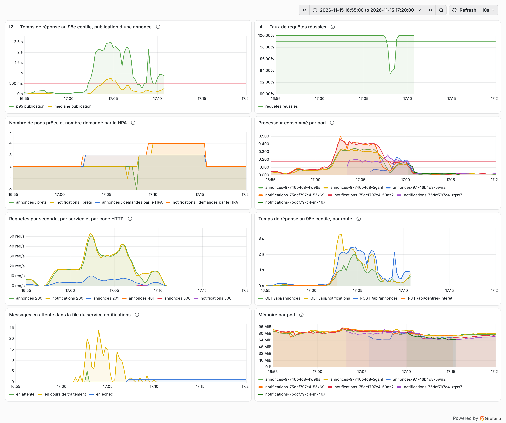

# Captures d'écran

Captures du tableau de bord Grafana du prototype. Elles sont prises par un script, sans affichage : `deploy/k8s/observabilite/capturer.sh`. Prometheus ne garde que 24 heures de mesures : une capture se prend le jour du test.

## Test de charge de référence — 15 novembre 2026, de 16 h 55 à 17 h 20

Exécution 3 du test de charge : 50 utilisateurs simultanés, puis 200, puis 50. Analyse dans le [document de l'étape 7, paragraphe 8.6](../07-deploiement-observabilite-charge.md). Paliers : charge nominale de 16 h 57 min 55 s à 17 h 00 min 55 s ; pointe de 17 h 01 min 55 s à 17 h 05 min 55 s ; retour à la charge nominale de 17 h 06 min 55 s à 17 h 09 min 55 s.



| Capture | Ce qu'il faut y lire |
|---|---|
| [Vue d'ensemble](charge-50-200-ensemble.png) | Les huit panneaux sur la même période |
| [I2 — temps de réponse d'une publication](charge-50-200-i2-temps-de-reponse.png) | Sous le seuil de 500 ms (trait rouge) à la charge nominale ; jusqu'à 2,5 s pendant la pointe ; un pic à 17 h 09, pendant le rétablissement |
| [I4 — taux de requêtes réussies](charge-50-200-i4-requetes-reussies.png) | 100 % à la charge nominale et pendant la pointe ; un creux à 93,4 % vers 17 h 08, quand le nœud est déclaré indisponible ; le trait marque le seuil de 99 % |
| [Pods prêts et pods demandés par le HPA](charge-50-200-pods-et-hpa.png) | Le HPA demande un troisième pod à 17 h 02 ; les pods ne sont prêts que vers 17 h 08 ; quatrième pod pour notifications à 17 h 09 ; retour à 2 pods à 17 h 15. Le creux des pods prêts vers 17 h 08 : le nœud déclaré indisponible |
| [Processeur par pod](charge-50-200-processeur-par-pod.png) | Le trait rouge est la cible du HPA, 0,175 cœur. Pendant la pointe, les deux pods de départ de chaque service la dépassent ; les pods ajoutés prennent leur part ensuite |
| [File du broker](charge-50-200-file-du-broker.png) | 5 messages en attente au plus ; jusqu'à 24 en cours de traitement pendant la pointe ; un message en échec à partir de 17 h 07 |

Les heures sont en heure locale. Le même relevé, en chiffres : [charge-50-200-supervision.csv](../../tests/resultats/charge-50-200-supervision.csv).

## Refaire une capture

```bash
deploy/k8s/observabilite/capturer.sh 2026-11-15T16:55 2026-11-15T17:20 docs/captures charge-50-200
```

Début et fin en heure locale, dossier de sortie, préfixe des fichiers. Le script ouvre Grafana le temps de la capture, puis le referme.
