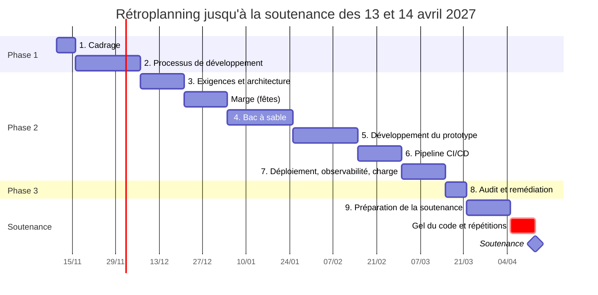

# Rétroplanning

Point de départ : mardi 10 novembre 2026. Soutenance : mardi 13 et mercredi 14 avril 2027. Il y a 22 semaines entre les deux.

Disponibilité : environ 2 heures par jour, week-ends compris (précisée le 12 novembre 2026), soit 14 heures par semaine et 308 heures au total.

## Calendrier

| Semaines | Dates | Étape | Budget | Jalon de fin |
|---|---|---|---|---|
| S1 | 10 au 15 novembre | 1. Cadrage | 14 h | Décisions validées, dépôt en ligne |
| S2 à S4 | 16 novembre au 6 décembre | 2. Processus de développement | 42 h | Indicateurs, cycle DevSecOps, schéma CI/CD, stratégie de tests, compétences et formation |
| S5 à S6 | 7 au 20 décembre | 3. Exigences et architecture | 28 h | Backlog et schéma d'architecture validés |
| S7 à S8 | 21 décembre au 3 janvier | Marge (fêtes de fin d'année) | 28 h au plus | — |
| S9 à S11 | 4 au 24 janvier | 4. Bac à sable | 42 h | Trois protocoles d'expérimentation rédigés |
| S12 à S14 | 25 janvier au 14 février | 5. Développement du prototype | 42 h | Chaque critère d'acceptation prouvé par un test |
| S15 à S16 | 15 au 28 février | 6. Pipeline CI/CD | 28 h | Pipeline réussi de bout en bout |
| S17 à S18 | 1er au 14 mars | 7. Déploiement, observabilité, charge | 28 h | Test de charge joué sur l'environnement cible |
| S19 | 15 au 21 mars | 8. Audit et remédiation | 14 h | Plan de remédiation priorisé |
| S20 à S21 | 22 mars au 4 avril | 9. Soutenance | 28 h | Support, script de démonstration, vidéo de secours |
| S22 | 5 au 12 avril | Gel du code et répétitions | 14 h | Deux répétitions chronométrées, plus aucune modification du code |
| — | 13 et 14 avril | Soutenance | — | — |

## Marges

- Deux semaines aux fêtes de fin d'année, utilisables pour rattraper un retard des étapes 2 et 3.
- La disponibilité compte déjà tous les jours de la semaine : il n'y a pas de réserve horaire en dehors de ces marges.
- Une semaine de gel avant la soutenance : seules les répétitions et la vérification de l'environnement de démonstration y sont permises.

## Points de tension

| Étape | Budget | Pourquoi c'est serré | Parade |
|---|---|---|---|
| 5. Développement du prototype | 42 h | Deux services, un broker, une base de données, l'authentification, et les tests écrits avant le code | L'étape 4 éprouve déjà les briques critiques : l'étape 5 réutilise leur configuration |
| 7. Déploiement, observabilité, charge | 28 h | Installation de l'environnement cible, sondes, mise à l'échelle automatique, observabilité, test de charge | Environnement cible commandé au plus tard le 28 février ; manifestes mis au point sur k3d, repris sans modification sur la cible (fiche 0003) |

## Échéances qui conditionnent la suite

| Échéance | Décision ou action | Étape bloquée sinon |
|---|---|---|
| 20 décembre 2026 | Réponse de l'intervenant sur l'« environnement managé » | 7 (choix de l'environnement cible) |
| 3 janvier 2027 | Comptes et accès prêts : SonarQube Cloud relié au dépôt, moteur de conteneurs et k3d installés sur le poste | 4 (bac à sable) |
| 28 février 2027 | Environnement cible commandé (machine virtuelle ou Kubernetes managé) | 7 (déploiement) |
| 5 avril 2027 | Gel du code, vidéo de secours enregistrée | Soutenance |

## Diagramme de Gantt

