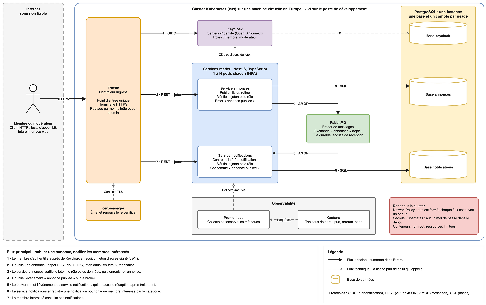

# Schéma — Architecture technique

Le schéma montre les composants du prototype, les zones de confiance, les protocoles et le flux principal : publier une annonce, puis notifier les membres intéressés. Le détail de chaque choix est dans le document d'[architecture](../03-architecture.md).



Source modifiable : [architecture-technique.drawio](architecture-technique.drawio), à ouvrir avec draw.io.

## Légende

| Élément | Sens |
|---|---|
| Cadre gris en pointillés | Internet : zone non fiable. Tout ce qui en vient est vérifié |
| Cadre bleu | Le cluster Kubernetes : seul Traefik y est joignable de l'extérieur |
| Flèche pleine numérotée | Flux principal, dans l'ordre de 1 à 7 |
| Flèche pointillée | Flux technique. La flèche part du composant qui appelle |
| Cylindre | Base de données |
| Encadré rouge | Mesures de sécurité qui s'appliquent à tout le cluster |

## Protocoles

| Sigle | Sens | Où |
|---|---|---|
| HTTPS | HTTP chiffré par TLS | Entre le client et Traefik |
| OIDC | OpenID Connect : protocole d'authentification bâti sur OAuth 2.0 | Entre le client et Keycloak |
| REST | Style d'API : des ressources manipulées par les verbes HTTP, ici en JSON | Entre le client et les services |
| AMQP | Protocole de messagerie de RabbitMQ | Entre les services et le broker |
| SQL | Langage de requête des bases relationnelles | Entre les services et PostgreSQL |

## Flux principal

| # | Étape | Protocole |
|---|---|---|
| 1 | Le membre s'authentifie auprès de Keycloak et reçoit un jeton d'accès signé (JWT) | OIDC sur HTTPS |
| 2 | Il publie une annonce, le jeton dans l'en-tête `Authorization` | REST sur HTTPS |
| 3 | Le service annonces vérifie le jeton, le rôle et les données, puis enregistre l'annonce | SQL |
| 4 | Il publie l'événement `annonce.publiee` sur le broker | AMQP |
| 5 | Le broker remet l'événement au service notifications, qui en accuse réception après traitement | AMQP |
| 6 | Le service notifications enregistre une notification pour chaque membre intéressé par la catégorie | SQL |
| 7 | Le membre intéressé consulte ses notifications | REST sur HTTPS |

Les deux services ne s'appellent jamais directement : ils ne communiquent que par le broker.

## Mise à jour du schéma

1. Modifier `architecture-technique.drawio` dans draw.io.
2. Régénérer l'image, depuis la racine du dépôt :

```bash
/Applications/draw.io.app/Contents/MacOS/draw.io -x -f png -s 2 -b 10 -o docs/schemas/architecture-technique.png docs/schemas/architecture-technique.drawio
```

Export vérifié le 12 novembre 2026 avec draw.io 29.6.1.
