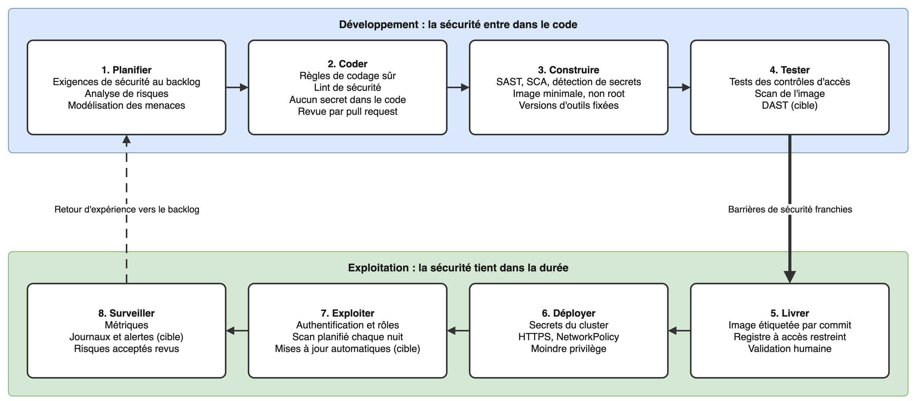

# Schéma — Cycle de vie DevSecOps

DevSecOps : organisation où le développement (Dev), la sécurité (Sec) et l'exploitation (Ops) partagent une même chaîne de livraison, et où la sécurité est vérifiée à chaque étape au lieu d'être auditée à la fin.

Le schéma montre les huit étapes du cycle et les mesures de sécurité de chacune. Le détail (outil, périmètre prototype ou cible) est dans le [processus de développement](../02-processus-developpement.md#3-cycle-de-vie-devsecops).



Source modifiable : [cycle-devsecops.drawio](cycle-devsecops.drawio), à ouvrir avec draw.io.

## Lecture

| Élément | Sens |
|---|---|
| Rangée du haut | Étapes 1 à 4 : ce qui se passe avant qu'une version soit livrable |
| Rangée du bas | Étapes 5 à 8 : ce qui se passe une fois la version livrée |
| Flèche épaisse | Une version ne passe en exploitation que si les contrôles bloquants du pipeline sont verts |
| Flèche pointillée | Ce que l'exploitation apprend (alerte, incident, nouvelle vulnérabilité) revient dans le backlog |

Sigles : SAST (analyse statique du code, sans l'exécuter), SCA (analyse des dépendances tierces), DAST (test de l'application en marche, vue de l'extérieur). « Cible » : mesure prévue pour la plateforme, pas réalisée dans le prototype.

## Mise à jour du schéma

1. Modifier `cycle-devsecops.drawio` dans draw.io.
2. Régénérer l'image, depuis la racine du dépôt :

```bash
/Applications/draw.io.app/Contents/MacOS/draw.io -x -f png -s 2 -b 10 -o docs/schemas/cycle-devsecops.png docs/schemas/cycle-devsecops.drawio
```

Export vérifié le 12 novembre 2026 avec draw.io 29.6.1.
