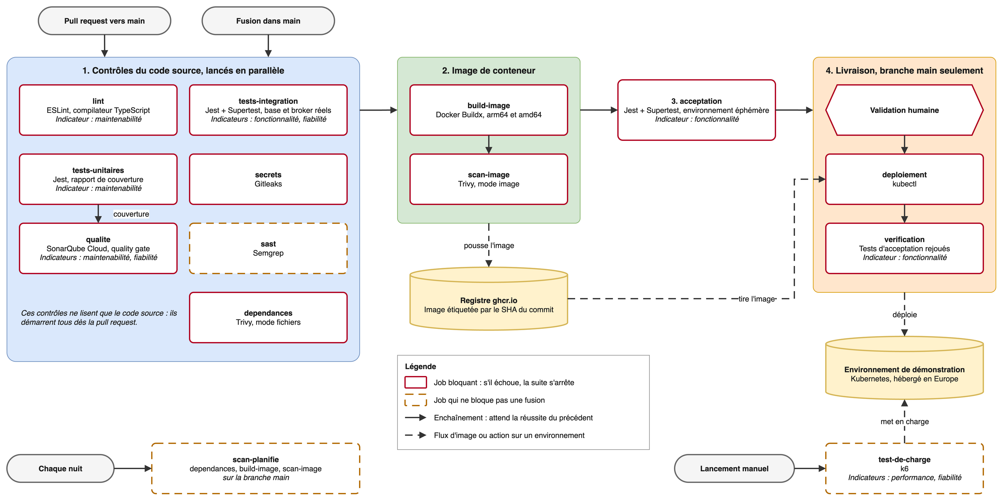

# Schéma — Pipeline CI/CD

CI/CD : l'intégration continue (CI) construit, teste et analyse chaque modification ; la livraison continue (CD) emballe puis déploie la version validée.

Le schéma montre les déclencheurs, les jobs (tâches du pipeline), leurs outils, les contrôles bloquants et l'indicateur de qualité que chaque job alimente. Le détail (artefacts, environnements, seuils) est dans le [processus de développement](../02-processus-developpement.md#4-processus-cicd).



Source modifiable : [pipeline-ci-cd.drawio](pipeline-ci-cd.drawio), à ouvrir avec draw.io.

## Légende

| Forme | Sens |
|---|---|
| Ovale gris | Déclencheur : l'événement qui lance le pipeline |
| Rectangle à bord rouge plein | Job bloquant : s'il échoue, la suite ne s'exécute pas et la fusion est refusée |
| Rectangle à bord orange pointillé | Job qui ne bloque pas une fusion : `sast` informe d'abord puis deviendra bloquant ; `scan-planifie` alerte ; `test-de-charge` est lancé à la demande |
| Hexagone | Validation humaine : une personne approuve le déploiement |
| Cylindre | Lieu de stockage ou d'exécution : registre d'images, environnement |
| Flèche pleine | Enchaînement : le job suivant attend la réussite du précédent |
| Flèche pointillée | Flux d'un artefact (image) ou action sur un environnement |

## Lecture en quatre temps

1. Les contrôles qui n'ont besoin que du code source démarrent tous en même temps, dès la pull request. Le retour au développeur est rapide.
2. L'image est construite une seule fois, pour deux architectures, et étiquetée par le SHA (identifiant unique) du commit. C'est cette image, et aucune autre, qui est scannée, testée puis déployée.
3. Les tests d'acceptation jouent les scénarios du backlog sur cette image, dans un environnement jetable.
4. Sur la branche `main` seulement, et après une validation humaine, l'image est déployée, puis les tests d'acceptation sont rejoués sur l'environnement déployé.

## Mise à jour du schéma

1. Modifier `pipeline-ci-cd.drawio` dans draw.io.
2. Régénérer l'image, depuis la racine du dépôt :

```bash
/Applications/draw.io.app/Contents/MacOS/draw.io -x -f png -s 2 -b 10 -o docs/schemas/pipeline-ci-cd.png docs/schemas/pipeline-ci-cd.drawio
```

Export vérifié le 12 novembre 2026 avec draw.io 29.6.1.
