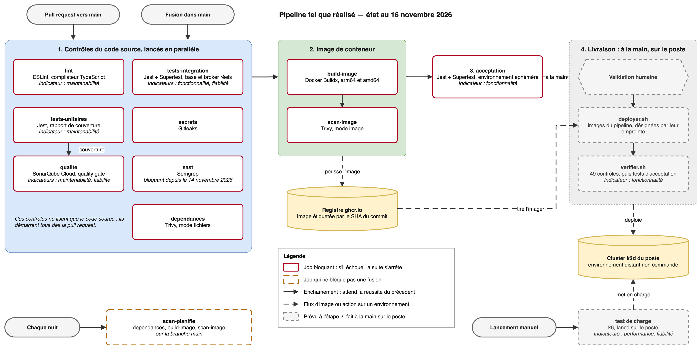

# Schéma — Pipeline CI/CD tel que réalisé

Ce schéma reprend le [schéma du pipeline de l'étape 2](pipeline-ci-cd.md) et y marque ce que la réalisation a changé. Il sert à la soutenance : le jury voit d'un coup d'œil ce qui tourne dans le pipeline et ce qui est fait à la main. État au 16 novembre 2026.

Le schéma de l'étape 2 reste la référence validée : il n'est pas réécrit.



Source modifiable : [pipeline-realise.drawio](pipeline-realise.drawio), à ouvrir avec draw.io.

## Ce qui diffère du schéma de l'étape 2

| Élément | Étape 2 | Réalisé | Preuve |
|---|---|---|---|
| `sast` | Informe d'abord, bloquant ensuite | Bloquant depuis le 14 novembre 2026, après trois exécutions sans constat | [Pipeline, paragraphe 7](../06-pipeline-ci-cd.md) |
| Temps 4 : validation, `deploiement`, `verification` | Jobs du pipeline, sur `main` | Faits à la main sur le poste : `deployer.sh` avec les images du pipeline désignées par leur empreinte, puis `verifier.sh` et les tests d'acceptation | [Déploiement, paragraphe 11](../07-deploiement-observabilite-charge.md) |
| `test-de-charge` | Job lancé à la demande | k6 lancé sur le poste | [Déploiement, paragraphe 8](../07-deploiement-observabilite-charge.md) |
| Environnement de démonstration | Cluster hébergé en Europe | Cluster k3d du poste : l'environnement distant n'est pas commandé | [Déploiement, paragraphe 2](../07-deploiement-observabilite-charge.md) |

Raison commune aux trois dernières lignes : les exécuteurs de GitHub ne joignent pas le poste. Elles tombent quand l'environnement distant existe.

Ce que le schéma ne montre pas : le job `qualite` reçoit la couverture des deux niveaux de tests, unitaires et d'intégration, et non des seuls tests unitaires.

## Légende

| Forme | Sens |
|---|---|
| Rectangle à bord rouge plein | Job bloquant du pipeline : s'il échoue, la suite ne s'exécute pas et la fusion est refusée |
| Rectangle à bord orange pointillé | Job qui ne bloque pas une fusion : `scan-planifie` alerte |
| Forme grise à bord pointillé | Prévu à l'étape 2, fait à la main sur le poste |
| Les autres formes | Celles du [schéma de l'étape 2](pipeline-ci-cd.md) |

## Mise à jour du schéma

1. Modifier `pipeline-realise.drawio` dans draw.io.
2. Régénérer l'image, depuis la racine du dépôt :

```bash
/Applications/draw.io.app/Contents/MacOS/draw.io -x -f png -s 2 -b 10 -o docs/schemas/pipeline-realise.png docs/schemas/pipeline-realise.drawio
```

Export vérifié le 16 novembre 2026 avec draw.io 29.6.1.
